# Phase 1 — Base infrastructure build notes

Build log for the local lab: virtual network, domain controller, Windows client, and Rocky Linux
host. Addressing and design rationale live in [network-plan.md](network-plan.md); this file records
what was actually done, what broke, and how it was verified.

## Environment

| | |
|---|---|
| Host | Windows 11, i5-11xxxH (6C/12T), 16 GB RAM, 512 GB SSD |
| Hypervisor | VMware Workstation Pro |
| Lab network | VMnet8 (NAT), `10.10.10.0/24` |

RAM is the binding constraint: 2 GB (DC) + 4 GB (client) + 6 GB (Rocky) = 12 GB, leaving ~4 GB for
the host. VMs are powered on per phase rather than all at once.

## Virtual network

VMnet8 reconfigured in **Virtual Network Editor** (requires *Change Settings* for admin rights):

- Subnet IP `10.10.10.0`, mask `255.255.255.0`
- NAT type, host virtual adapter connected (`VMware Network Adapter VMnet8` = `10.10.10.1`)
- Local DHCP service disabled — VMs are statically addressed

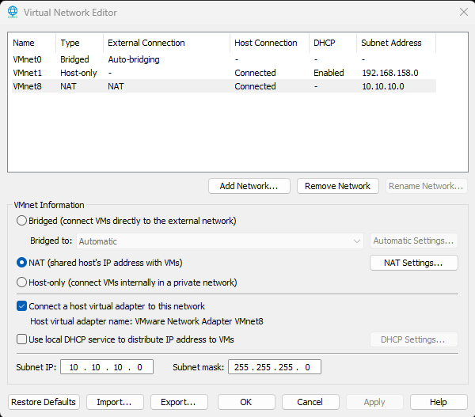

Each VM's adapter is set to **Custom: Specific virtual network → VMnet8 (NAT)** rather than the
generic "NAT" radio button, so the target network is explicit in the VM config.

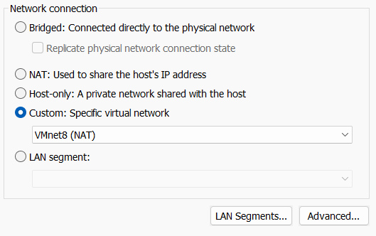

## Static addressing

Configured from an elevated PowerShell session on each Windows host. The `Remove-*` lines make the
sequence idempotent — safe to re-run whether the interface is fresh, on APIPA, or already configured.

```powershell
$if = "Ethernet0"

Set-NetIPInterface -InterfaceAlias $if -Dhcp Disabled

Remove-NetIPAddress -InterfaceAlias $if -AddressFamily IPv4 -Confirm:$false -ErrorAction SilentlyContinue
Remove-NetRoute -InterfaceAlias $if -DestinationPrefix 0.0.0.0/0 -Confirm:$false -ErrorAction SilentlyContinue

New-NetIPAddress -InterfaceAlias $if -IPAddress <address> -PrefixLength 24 -DefaultGateway 10.10.10.2

Set-DnsClientServerAddress -InterfaceAlias $if -ServerAddresses 10.10.10.10
```

**Domain controller — `10.10.10.10`**, DNS pointed at itself.

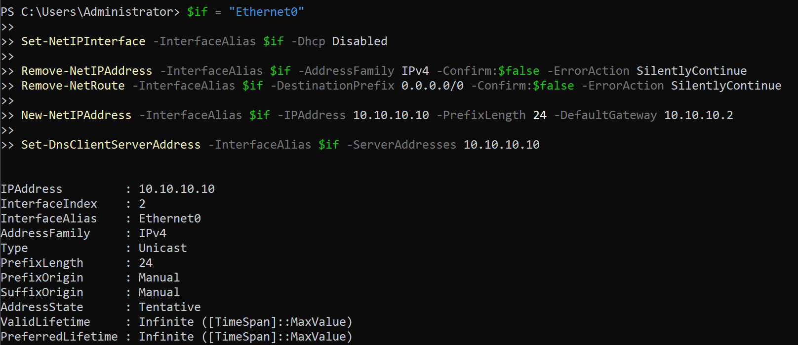

**Windows 10 client — `10.10.10.30`**, DNS pointed at the DC.

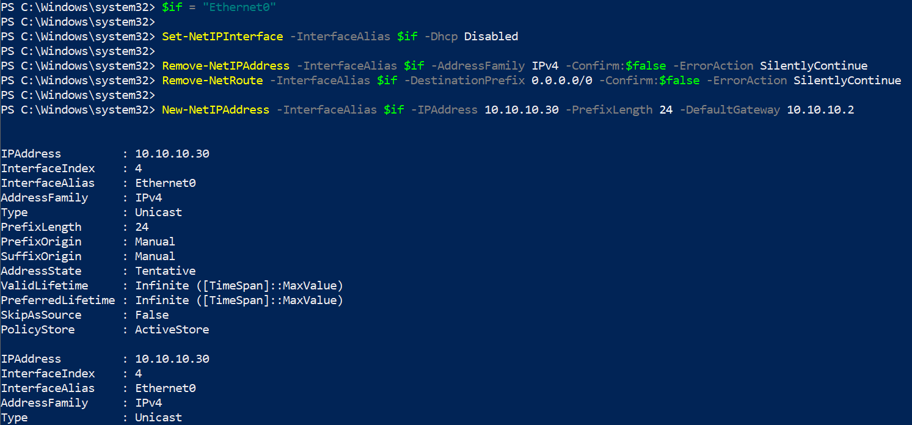

`AddressState: Tentative` in both outputs is Duplicate Address Detection in progress; it settles to
`Preferred` within a couple of seconds.

## Rocky Linux host — `10.10.10.20`

**Rocky Linux 10.2, Minimal ISO** (2.57 GB). Minimal rather than DVD (14.15 GB) because this box is a
headless server: both images install without needing network access, but Minimal skips a package
library that would go unused — everything the host needs comes from network repos over NAT.

Install choices:

| Setting | Value |
|---|---|
| Software selection | Minimal Install |
| Time & date | Europe/Rome |
| Partitioning | Automatic |
| KDUMP | Disabled — reclaims reserved RAM on a memory-constrained VM |
| Hostname | `wazuh-manager` |
| Root SSH login | Disabled; admin access via a `wheel`-group user |
| FIPS mode | Not enabled — see below |

Networking was configured during installation rather than post-install. Note the interface is
**`ens160`** (VMware's name on Linux, not `Ethernet0`), and VMware assigned the paravirtualised
**VMXNET3** adapter automatically.

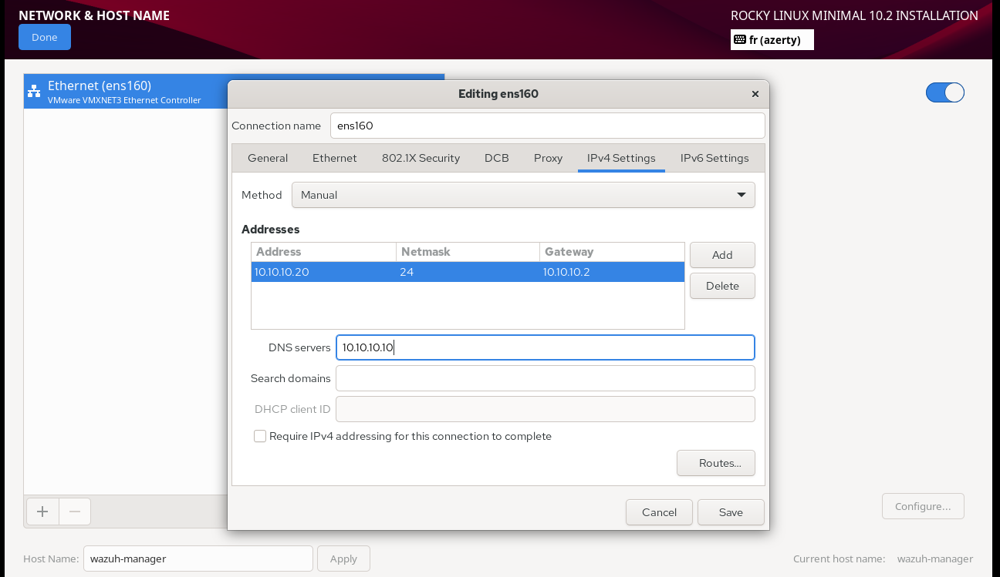

> The screenshot captures the initial entry of `10.10.10.10` only; `10.10.10.2` was added alongside it
> before the install completed. Final configuration is both, in that order.

### DNS: domain controller first, NAT gateway as fallback

Final configuration is **`10.10.10.10, 10.10.10.2`** — the DC first, the NAT gateway second.

The DC alone was rejected. RAM constraints mean only the VMs a given phase needs are powered on, so the
DC is frequently down; with it as sole resolver, `dnf` and the Wazuh installer fail to resolve anything
and surface as timeouts that give no hint a powered-off VM is the cause.

The gateway alone was also viable — this host is not domain-joined and Wazuh agents reach it by IP, so
it has no functional need to resolve `soclab.local` names. Keeping the DC first was chosen anyway, for
the convenience of addressing lab hosts by name.

**Accepted cost:** glibc's resolver walks nameservers in order with a ~5 s timeout, so while the DC is
powered off every lookup stalls before falling through to the gateway. If that becomes irritating,
NetworkManager can shorten it rather than requiring the list to change:

```bash
nmcli con mod ens160 ipv4.dns-options "timeout:1,attempts:1"
```

Note this arrangement is specific to a **non-domain-joined** host. The Windows client must use the DC
and *only* the DC, because a fallback resolver silently breaks the SRV lookups AD clients depend on to
locate the domain. If this host is ever joined via SSSD/realmd, the same restriction starts applying to
it too.

### FIPS mode

Installed in normal mode. FIPS 140-2/140-3 is a US federal cryptographic standard; none of the 23 job
descriptions this lab targets mention it, and Italian/EU frameworks (GDPR, NIS 2, ISO 27001) do not
require it. It also restricts algorithms in ways that commonly break SSH access, package tooling, and
Java-based stacks — OpenSearch under FIPS needs a certified JCE provider and extra JVM configuration,
which would obstruct the Wazuh install for no benefit here.

FIPS can be enabled post-install (`fips-mode-setup --enable`) if a future role ever calls for it, ideally
from a snapshot so the fallout can be documented and rolled back.

### Version note

Planning documents were written against Rocky Linux 9; the build uses **10.2**.

Wazuh's *agent* package list covers "RockyLinux 10 and later", but the central components (server,
indexer, dashboard) are a separate matter. The documentation's recommended-OS list names RHEL 7–10,
CentOS Stream 10, Amazon Linux and Ubuntu, and does not mention Rocky. The 4.14 installation assistant
accepts `rocky` as a distribution but treats only **9.4** as recommended, so on 10.2 it prints a
"does not match the list of recommended systems" warning and proceeds. Rocky is a RHEL rebuild and
RHEL 10 is on the documented list, so this is expected to work, but it is untested territory rather
than a supported configuration.

### Verified configuration

Address and interface state — `10.10.10.20/24` on `ens160`, link `UP`:

```bash
ip -4 addr show ens160
```

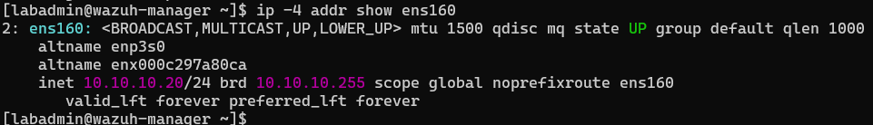

Routing — default route via the NAT gateway, plus the directly-connected lab subnet:

```bash
ip route
```

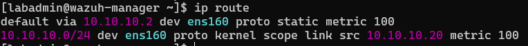

Resolver — both nameservers present in the order configured, written by NetworkManager:

```bash
cat /etc/resolv.conf
```

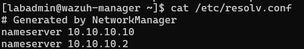

Note `/etc/resolv.conf` is **generated by NetworkManager**; editing it directly does not persist across
reboots or connection restarts. Resolver changes belong in `nmcli con mod ens160 ipv4.dns ...`.

### SSH key authentication

An Ed25519 key pair was generated on the lab host, protected by a passphrase, and the public key installed
for `labadmin`:

```powershell
ssh-keygen -t ed25519 -f "$HOME\.ssh\mini-soc_ed25519" -C "mini-soc lab"
scp .\mini-soc_ed25519.pub labadmin@10.10.10.20:/tmp/mini-soc.pub
```

The public key is appended to `~/.ssh/authorized_keys` on Rocky with `.ssh` at `700` and the file at
`600`, then `restorecon -R ~/.ssh` resets the SELinux label — a wrong label there makes key login fail
silently on RHEL-family systems. `scp` was used instead of piping the file through PowerShell 5.1, which
can introduce Windows line endings that make `authorized_keys` unreadable.

Verified from a verbose client handshake: the server **accepts the key's fingerprint**
(`Server accepts key: ... ED25519 SHA256:dWt1...`). A non-interactive test cannot supply the passphrase, so
the final login was completed interactively.

Password login is left enabled on purpose. Disabling it (`PasswordAuthentication no`,
`PermitRootLogin no`) is a CIS control, so it belongs in Phase 5 where its effect on the score is
measured, rather than being changed quietly beforehand. Key files are excluded by `.gitignore`.

## Domain controller — Active Directory Domain Services

The DC hosts **AD DS**, the directory service the rest of the Windows lab depends on. It provides four
things: a central database of users, computers and groups; authentication (Kerberos, with NTLM as
legacy fallback); authorization via group membership; and centralised configuration through Group
Policy. Clients locate it through DNS SRV records, which is why the DC also runs DNS and why domain
members must resolve against it.

Role installation:

```powershell
Install-WindowsFeature -Name AD-Domain-Services -IncludeManagementTools
```

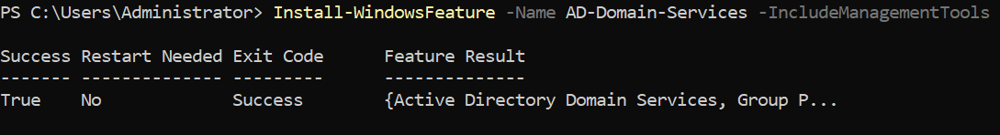

`-IncludeManagementTools` pulls in Active Directory Users and Computers and the Group Policy console —
without it the domain is created but has no graphical administration tools.

Promotion to a new forest:

```powershell
Install-ADDSForest -DomainName "soclab.local" -DomainNetbiosName "SOCLAB" -InstallDns:$true -Force:$true
```

Prompts for the DSRM (Directory Services Restore Mode) password and reboots on completion.

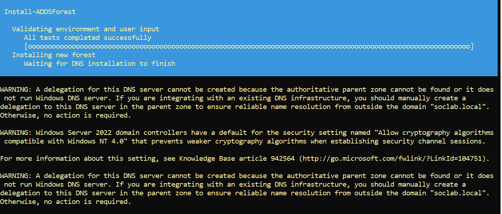

Two warnings appear during promotion. Both are expected here and neither requires action:

**"A delegation for this DNS server cannot be created."** Standard DNS practice when creating a new
zone is to add a delegation record in the *parent* zone pointing at the new authoritative server. The
parent of `soclab.local` would be `.local`, which is not a real delegable zone — it is reserved for
mDNS. With no parent zone and no external DNS infrastructure to integrate with, there is nothing to
delegate from. The message itself ends *"Otherwise, no action is required."* This is a direct
consequence of the `.local` naming choice noted below.

**"Allow cryptography algorithms compatible with Windows NT 4.0."** Despite being flagged as a warning,
this announces a *secure* default: Server 2022 domain controllers refuse weak cryptography when
establishing Netlogon secure-channel sessions. It would only matter if NT 4.0-era clients needed to
authenticate against this domain. Nothing to change.

Post-promotion, a forwarder is required:

```powershell
Add-DnsServerForwarder -IPAddress 10.10.10.2
```

This affects far more than the DC itself. Domain members use the DC as their **only** resolver, and the
DC is authoritative only for `soclab.local` — so every public lookup a client makes depends on what the
DC does with queries outside its own zone:

```
Win10 client  →  DC (10.10.10.10)  →  forwarder (10.10.10.2)  →  internet
```

Without the forwarder, clients fail to resolve anything public despite having entirely correct local
network configuration — the fault sits one hop upstream. This is also why domain members can safely be
restricted to the DC alone: resolution is not being cut off, it is being routed through a server that
handles the upstream half.

Windows DNS does fall back to **root hints** when no forwarder is set, performing recursion from the
root servers itself, so the symptom is usually slow and intermittent resolution rather than outright
failure — which is harder to diagnose than a clean break. Forwarding is faster (one hop to a warm
cache), more reliable (root-hint recursion needs outbound DNS to arbitrary hosts, often filtered), and
consistent with the rest of the lab, where `10.10.10.2` is already the resolution path.

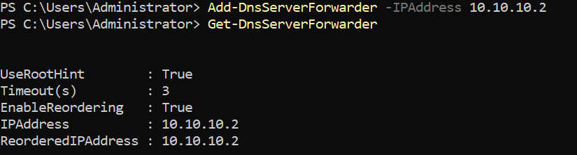

The resulting configuration shows `UseRootHint : True` — the forwarder is tried first with a 3-second
timeout, and root-hint recursion remains available as a fallback rather than being replaced. That
layering is the default and is worth keeping: the forwarder handles the normal case efficiently, while
the fallback means a failed forwarder degrades resolution rather than removing it.

Confirming public resolution now works from the DC:

```powershell
Resolve-DnsName microsoft.com
```

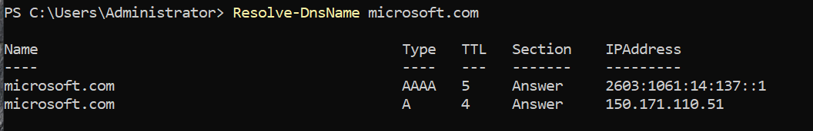

Both A and AAAA records return, confirming the forwarder path is functional and that IPv6 remains
enabled — deliberately, since Microsoft advises against disabling it on domain controllers.

This proves the DC half of the chain only. The equivalent query run **from a domain member** is the
test that matters for clients, since it exercises the full path: client → DC → forwarder → internet.

Verification — the second command queries the exact SRV record domain members use to locate a DC:

```powershell
Get-ADDomain | Select-Object DNSRoot, NetBIOSName, DomainMode
Resolve-DnsName -Name "_ldap._tcp.dc._msdcs.soclab.local" -Type SRV
```

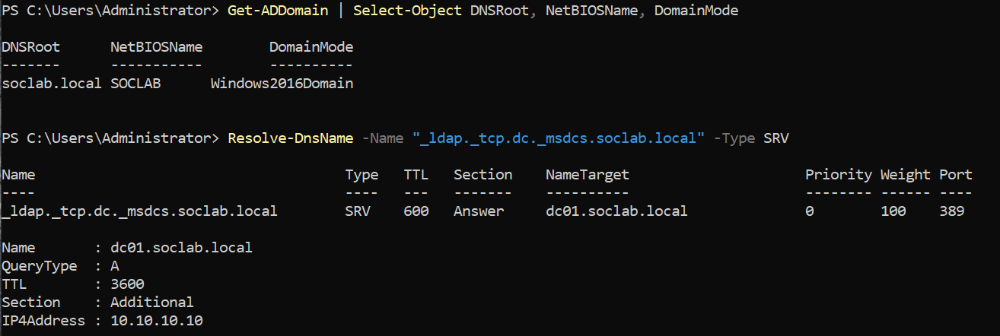

Three things confirmed here:

- The SRV record resolves to **`dc01.soclab.local`** on port 389 (LDAP), and the Additional section
  returns its A record as `10.10.10.10` — so a client gets both the DC's name and address from a single
  query. This is the lookup a domain join depends on; if it fails, the join fails with errors that never
  mention DNS.
- The target being `dc01` confirms the machine was renamed **before** promotion. Renaming a domain
  controller afterwards is substantially more involved.
- `DomainMode: Windows2016Domain` is the expected value despite this being Server 2022 — no new domain
  functional level has been introduced since Server 2016, so that is the current maximum. There is no
  "Windows2022Domain".

### Why this matters for the lab

AD DS is not just Windows plumbing — it is the primary target in most enterprise intrusions, and the
richest source of security telemetry the lab will produce. Domain logons, Kerberos ticket requests,
account and group changes, and privilege use all originate here, and the Phase 4 attack techniques
(Kerberoasting, AS-REP roasting, pass-the-hash, DCSync) are attacks against this service specifically.
Deploying the Wazuh agents onto domain-joined machines rather than standalone ones is what makes that
telemetry realistic.

### Naming note

`soclab.local` follows common lab convention, but `.local` is formally reserved for mDNS/Bonjour
(RFC 6762). Current Microsoft guidance is to use a subdomain of a domain actually owned
(`ad.example.com`) to avoid resolution conflicts. Retained here as it is isolated and conflict-free.

## Directory structure — OUs and users

Organisational units created to give the domain a shape resembling a small organisation, rather than
leaving every object in the default `Users` container:

```powershell
New-ADOrganizationalUnit -Name "IT" -Path "DC=soclab,DC=local"
New-ADOrganizationalUnit -Name "Finance" -Path "DC=soclab,DC=local"
New-ADOrganizationalUnit -Name "HR" -Path "DC=soclab,DC=local"
```

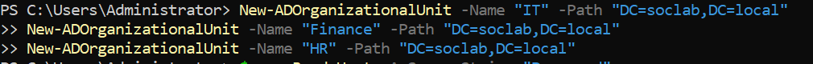

OUs matter beyond tidiness: Group Policy links to OUs but **not** to the built-in `Users` and
`Computers` containers, which are containers rather than organisational units. Anything left in the
default location cannot be targeted by policy.

Standard (non-administrative) users were created inside those OUs:

```powershell
$pw = Read-Host -AsSecureString "Password"
New-ADUser -Name "Roberto Carlos" -SamAccountName "rcarlos" -UserPrincipalName "rcarlos@soclab.local" -Path "OU=HR,DC=soclab,DC=local" -AccountPassword $pw -Enabled $true
```

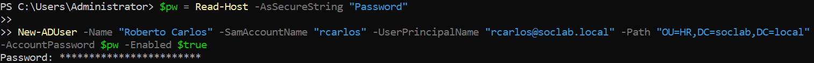

Passing `-Path` places the account in a specific OU. Omitting it drops the object into the default
`Users` container, where Group Policy cannot reach it.

Ordinary user accounts are needed for three reasons. Wazuh has no baseline of normal activity if every
logon in the environment is a Domain Admin logon. Phase 4 attack chains need a low-privilege starting
point to escalate *from* — beginning as Domain Admin means there is nothing left to demonstrate. And
routine use of a privileged account on a workstation caches Domain Admin credential material in LSASS
on that machine, which is the precise condition those attacks exploit.

Resulting directory contents:

```powershell
Get-ADUser -Filter * | Select-Object Name, SamAccountName, Enabled, DistinguishedName
```

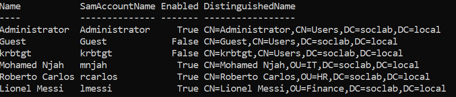

Three built-in accounts appear alongside the created users. `Guest` and `krbtgt` are disabled by
default. **`krbtgt`** is the Kerberos service account: its password hash signs every ticket issued in
the domain, so an attacker holding that hash can forge a Golden Ticket — a valid TGT for any principal,
including non-existent ones — until the hash is rotated. It is the single highest-value secret in the
directory, and the reason post-compromise guidance calls for resetting it twice.

Note also that the built-ins sit in `CN=Users` while the created accounts sit in `OU=IT`, `OU=HR` and
`OU=Finance` — the container-versus-OU distinction visible directly in the distinguished names.

## Domain join — client pre-flight verification

Two checks run **from the Windows client** before attempting the join. Both must pass; a failure here
would otherwise surface as a domain-join error that gives no indication DNS is the cause.

```powershell
Resolve-DnsName -Name "_ldap._tcp.dc._msdcs.soclab.local" -Type SRV
Resolve-DnsName microsoft.com
```

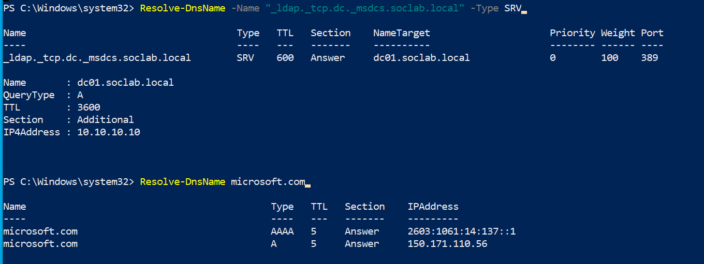

The first proves the client can **locate the domain** — the SRV record returns `dc01.soclab.local` on
port 389, with the Additional section supplying its address (`10.10.10.10`). This is the DC locator
query every domain member issues at boot and at logon.

The second proves the **full resolution chain** works from the client's position:
client → DC → forwarder → internet. Verifying public resolution on the DC alone is insufficient, since
the client depends on the DC for every lookup outside `soclab.local`.

Both commands returning answers is the go/no-go for the join. Note the first of these timed out earlier
in this build — see the client DNS entry under *What broke* below.

Join, run from the client:

```powershell
Add-Computer -DomainName "soclab.local" -Credential (Get-Credential SOCLAB\Administrator) -Restart
```

Confirmed from the DC, where the AD PowerShell module is present (it ships with the management tools
installed alongside the AD DS role; Windows clients need RSAT added separately):

```powershell
Get-ADComputer -Filter * | Select-Object Name, DNSHostName, Enabled
```

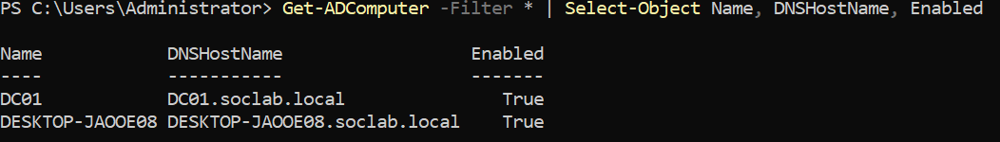

Both computer objects are registered and enabled, each with a fully-qualified DNS host name under
`soclab.local`.

### Client hostname

The client joined under its Windows-generated name (`DESKTOP-JAOOE08`). Renamed to a meaningful value
before Phase 2, since the hostname propagates into every Wazuh alert and detection, and a generated
name makes cross-host correlation harder to read:

```powershell
Rename-Computer -NewName "WIN10-CLIENT" -DomainCredential SOCLAB\Administrator -Restart
```

Timing matters: the Wazuh agent registers against the hostname, so renaming after enrolment would
require re-registering the agent and would leave historical alerts under the previous name. Renaming a
domain-joined workstation is straightforward — unlike a domain controller, where the rename must happen
before promotion.

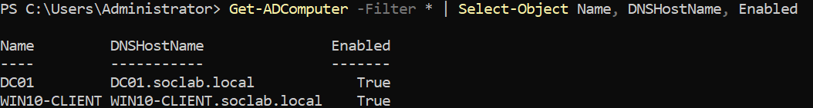

Passing `-DomainCredential` is what makes the rename propagate: both the directory object and its
`DNSHostName` attribute are updated, not just the local machine name. Without it the workstation would
have renamed locally while the directory retained the old entry, breaking the computer account's trust
relationship with the domain.

## What broke

### VMware Easy Install vs. the Windows Server evaluation ISO

**Symptom:** Setup failed immediately with *"Windows cannot find the Microsoft Software License
Terms. Make sure the installation sources are valid and restart the installation."*

**Cause:** Pointing the New Virtual Machine wizard at the ISO silently enables VMware's *Easy
Install*, which generates an `autounattend.xml` answer file and attaches it via a hidden virtual
floppy drive. The generated file specifies a product key and edition index that don't exist in an
evaluation ISO (which ships four editions and expects no key), so Setup cannot resolve the matching
licence terms.

**Ruled out first:** ISO integrity — the file was a complete 5,044,094,976 bytes, matching the
published size, so the download was not truncated.

**Fix:** Remove the **Floppy** device from VM Settings → Hardware, which deletes the answer file from
the VM. For subsequent VMs, avoid the problem entirely by choosing **"I will install the operating
system later"** in the New Virtual Machine wizard, then attaching the ISO to the CD/DVD device
afterwards.

**Applies to:** every VM in this lab, Rocky Linux included — Easy Install causes comparable problems
on Linux guests.

### New-ADUser is not atomic — failed password leaves a half-created account

**Symptom:** Creating a user with a password that failed the domain policy produced
`ADPasswordComplexityException`. Retrying the identical command with a compliant password then failed
with a *different* error — `ADIdentityAlreadyExistsException: The specified account already exists`.

**Cause:** `New-ADUser` writes the user object to the directory **first**, then applies the password as
a separate operation. When the password is rejected, the object has already been created. It is left
disabled with no password set, and the retry collides with it.

**Diagnosis:**

```powershell
Get-ADUser -Identity mnjah -Properties Enabled, PasswordLastSet |
    Select-Object Name, SamAccountName, Enabled, PasswordLastSet
```

The account exists with `Enabled: False` and no `PasswordLastSet`, confirming partial creation rather
than a stale duplicate.

**Fix** — complete the existing object instead of deleting and recreating:

```powershell
Set-ADAccountPassword -Identity mnjah -NewPassword (Read-Host -AsSecureString "Password") -Reset
Enable-ADAccount -Identity mnjah
```

**Takeaway:** a failed cmdlet does not imply nothing changed. Directory operations that touch multiple
attributes can partially apply, so verify state before retrying rather than assuming a clean slate.

The governing policy is worth inspecting directly:

```powershell
Get-ADDefaultDomainPasswordPolicy
```

Note `LockoutThreshold: 0` in the defaults — no account lockout is configured. Convenient for Phase 4
brute-force simulation, since accounts will not lock during testing, but it is also a genuine
misconfiguration and a CIS control that Phase 5 should address.

### Client SRV lookup timing out — no DNS server configured

**Symptom:** Running the domain-locator lookup on the Windows client failed with a bare timeout:

```
Resolve-DnsName : _ldap._tcp.dc._msdcs.soclab.local : This operation returned because the
timeout period expired
```

**Cause:** The client had **no DNS server set at all**. `Get-DnsClientServerAddress` returned an empty
set (`{}`). During initial static addressing, `New-NetIPAddress` ran but `Set-DnsClientServerAddress`
did not — the address, mask and gateway were all correct, so nothing looked wrong until a name actually
had to be resolved.

**Why it was not obvious:** the error reports a timeout, not a missing resolver. `ipconfig` output looks
entirely healthy — correct IP, mask and gateway — because DNS is a separate setting that `ipconfig`
only surfaces once populated. The same failure would have appeared later as an unexplained domain-join
error.

**Diagnosis:**

```powershell
Get-DnsClientServerAddress -InterfaceAlias Ethernet0 -AddressFamily IPv4   # returned {}
Test-NetConnection 10.10.10.10 -Port 53                                   # TcpTestSucceeded: True
```

The second command was the discriminator: the DC was reachable and serving DNS on port 53, which ruled
out the server, the network path and the firewall in one step and localised the fault to client
configuration.

**Fix:**

```powershell
Set-DnsClientServerAddress -InterfaceAlias Ethernet0 -ServerAddresses 10.10.10.10
```

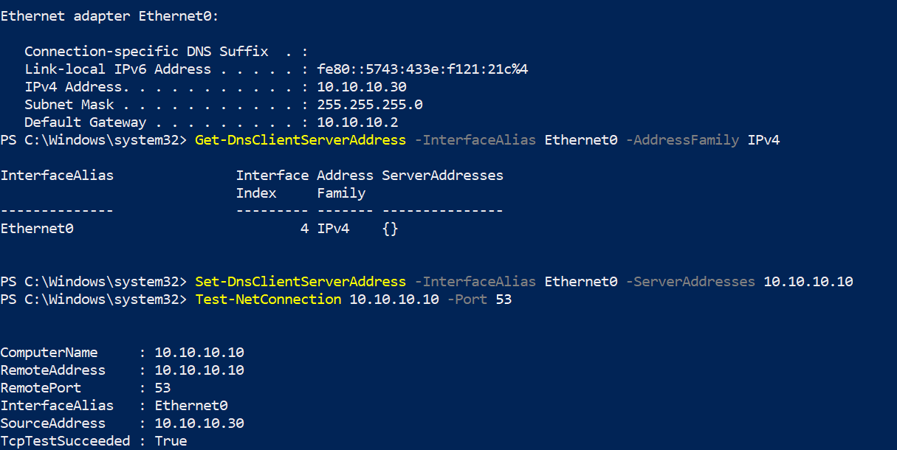

**Takeaway:** verify DNS explicitly after setting a static address rather than inferring it from
`ipconfig`. A host with a correct address and no resolver looks identical to a working one until
something tries to resolve a name.

### Windows Server password complexity at first logon

**Symptom:** The initial Administrator password was rejected as not meeting complexity requirements.

**Cause:** The default policy requires three of four character classes (upper, lower, digit, symbol),
a minimum length, and rejects passwords containing the account name.

**Worth noting:** the installer's keyboard layout may not match the physical keyboard, so symbols can
land on different keys than expected. The eye icon on the password field confirms what was actually
typed.

## Verification

From the Windows client, with the DC powered on:

```powershell
Get-NetIPConfiguration                                  # address, gateway, DNS
Get-DnsClientServerAddress -InterfaceAlias Ethernet0 -AddressFamily IPv4
Test-NetConnection 10.10.10.10 -InformationLevel Quiet  # lab connectivity
Test-NetConnection 1.1.1.1 -InformationLevel Quiet      # NAT to internet
```

Expected: static addresses with `PrefixOrigin: Manual`, gateway `10.10.10.2`, DNS `10.10.10.10` only,
and both connection tests returning `True`.

## Outstanding

- [x] Disable the local DHCP service on VMnet8. Nothing was breaking while every host was static, but
      leaving it enabled meant any future VM — a Kali host in Phase 4, a second client — would receive
      an address *plus VMware's DNS server*, which is exactly the condition that breaks AD domain
      joins. The cause would be a checkbox on the hypervisor rather than anything visible on the VM.
- [x] Confirm the client's DNS is `10.10.10.10` and nothing else — no public resolver as a secondary.
- [x] Promote the DC to AD DS, create the `soclab.local` domain, and add a DNS forwarder to
      `10.10.10.2` so the DC can still resolve public names.
- [x] Build the Rocky Linux host at `10.10.10.20`.
- [x] Join the client to the domain and confirm the computer object registered in the directory.
- [x] Rename the client from its Windows-generated name to `WIN10-CLIENT`, before agent enrolment.
- [x] Install `open-vm-tools` on the Rocky host and enable `vmtoolsd`.
- [x] Snapshot the Rocky host as a clean baseline (`01-clean-rocky-baseline`) before Phase 2. Taken
      before the Wazuh install, which brings in OpenSearch, a JVM, generated certificates and several
      systemd units — enough moving parts that a rollback point is worth more than the disk it costs.
- [x] Create the AD user and OU structure — `IT`, `Finance` and `HR`, each with a standard user account.

**Phase 1 complete.** The lab now has an isolated network with static addressing, a functioning
`soclab.local` domain with a domain-joined workstation, a directory populated with OUs and ordinary
user accounts, and a Rocky Linux host snapshotted and ready to become the Wazuh manager.

## Known limitations

- **Single-filesystem layout.** Automatic partitioning puts everything on one root filesystem, so
  several CIS Benchmark controls covering separate `/var`, `/var/log`, `/var/tmp`, `/home` and `/tmp`
  partitions cannot be satisfied without rebuilding the VM. Accepted knowingly: manual LVM layout was
  judged not worth the complexity before the SIEM was even installed, at the cost of a few points on
  the Phase 5 compliance score.
- **Flat network.** All hosts share one broadcast domain with no segmentation between the domain
  controller, the workstation and the SIEM. A production network would separate these into VLANs with
  firewall policy between them, which is what constrains lateral movement after a workstation is
  compromised — so Phase 4 attacks will move laterally more easily here than they would in a real
  environment.
