# Phase 2 — Wazuh SIEM/XDR build notes

Deployment of the Wazuh manager on the Rocky Linux host (`10.10.10.20`, `wazuh-manager`), followed by
agent enrolment on the Windows hosts. Addressing is in [network-plan.md](network-plan.md); the host
itself is documented in [phase-1-build-notes.md](phase-1-build-notes.md).

## Installation

Wazuh **4.14.9**, deployed all-in-one (indexer, server and dashboard on one host) using the official
installation assistant, run over SSH from the lab host with only the Rocky VM powered on — the install
has no dependency on the Windows VMs, so leaving them off kept RAM free for it.

```bash
curl -sO https://packages.wazuh.com/4.14/wazuh-install.sh
sudo bash ./wazuh-install.sh -a
```

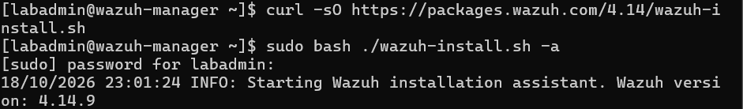

The installer ran from 23:01:24 to 23:09:32 — about eight minutes — and finished with the dashboard
initialised and the generated `admin` credentials printed.

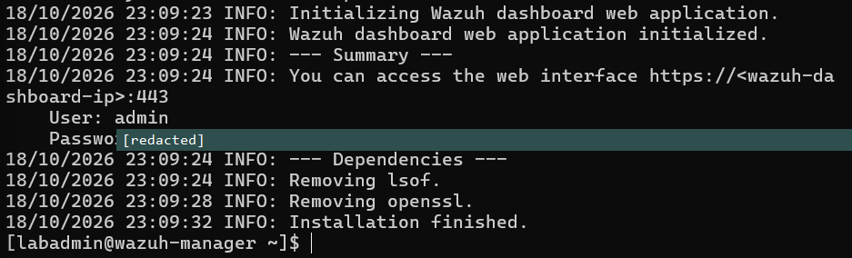

The generated password is deliberately redacted in the screenshot above. The installer prints it once
to the terminal, so it is recorded in a local, gitignored credentials file rather than in this
repository. Screenshots of that screen are the one place in this project where a routine documentation
habit would publish a real credential.

### Before running it

The installation assistant was read before being executed, which turned up several things worth
recording:

- **Rocky 10.2 is outside the installer's recommended list.** `check_dist` accepts `rocky` as a
  distribution but treats only 9.4 as recommended; anything else sets a flag that prints a warning and
  continues rather than aborting. The documentation's recommended-OS list covers RHEL 7–10 and CentOS
  Stream 10, so this is an untested configuration rather than an unsupported one.
- **The hardware check passes, but the lab sits below the recommendation.** The script's hard
  minimum is 2 cores and roughly 4 GB of RAM for the all-in-one install. The quickstart documentation
  recommends 4 vCPU and 8 GiB for 1–25 agents. This VM has 4 vCPU and 6 GB, which is adequate for a
  two-agent lab but short of the guidance.
- **The indexer heap is probably fixed at 1 GB.** The script derives the OpenSearch heap from a
  variable (`ram_mb`) that is never defined, so the arithmetic evaluates to zero and falls back to a
  1024 MB default regardless of the VM's memory. Inferred from reading the script, not yet observed —
  see the verification list below.

## Firewall

`firewalld` blocks everything outside its default services, so the Wazuh ports were opened explicitly:

```bash
sudo firewall-cmd --permanent --add-port={443,1514,1515,55000}/tcp && sudo firewall-cmd --reload
```

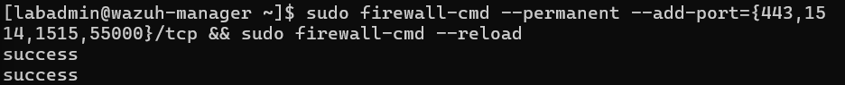

| Port | Purpose |
|---|---|
| 443/tcp | Dashboard web interface |
| 1514/tcp | Agent event traffic |
| 1515/tcp | Agent enrolment |
| 55000/tcp | Wazuh API |

firewalld keeps *runtime* and *permanent* configuration separately: `--permanent` saves a rule without
activating it, and `--reload` applies the saved set. The two `success` lines are one for each half.
The brace expansion is done by bash, not firewalld, and produces four `--add-port` arguments.

All four ports are inbound to the manager; the Windows agents connect outward and need no rules.
Port 9200 (the indexer) is deliberately left closed, since the dashboard reaches it locally.

Rules were applied to the whole `public` zone, so any host that can reach the manager can reach these
ports. Acceptable on a flat lab network; a production deployment would restrict sources to the agent
subnet with a rich rule.

## Verification

All three services report `active`:

```bash
sudo systemctl is-active wazuh-manager wazuh-indexer wazuh-dashboard
```

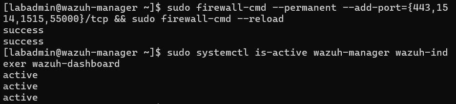

The dashboard is reachable at `https://10.10.10.20` from the lab host and the login succeeds. The
browser flags the connection as not secure because the installer generates a self-signed certificate;
that is expected on an isolated lab network and would be replaced with a CA-issued certificate in a
real deployment.

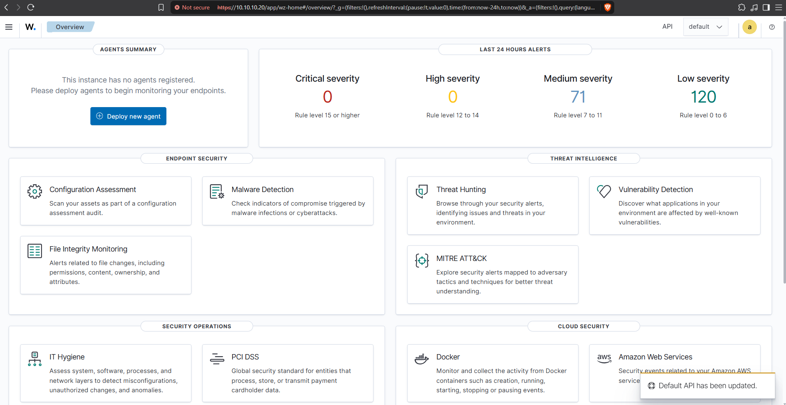

This confirms the stack runs on Rocky 10.2 despite the installer's recommended-OS warning, so the
untested-configuration caveat above can be treated as resolved for this version.

The overview shows **no agents registered** — as expected, none have been enrolled — yet already
reports 71 medium and 120 low severity alerts for the last 24 hours. With no agents, these are most
likely the manager monitoring itself, which Wazuh does through a built-in local agent (ID `000`). The
source has not been confirmed. It matters because it is the first baseline of "normal" noise: Phase 4
detections will need to be distinguished from it, and the Phase 5 configuration-assessment findings
will start from whatever the manager already reports about its own host.

### Post-install checks

```bash
sudo grep -E "^-Xm[sx]" /etc/wazuh-indexer/jvm.options
sudo firewall-cmd --list-ports
sudo ausearch -m avc -ts recent
```

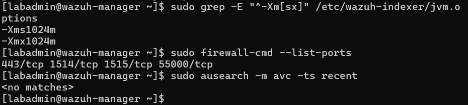

- **Indexer heap is 1024 MB** (`-Xms1024m`, `-Xmx1024m`). This confirms the reading of the installer:
  the heap is derived from a variable that is never defined, so it falls back to a fixed 1 GB whatever
  the VM's memory. The file is root-readable only, hence `sudo` on a plain `grep`.
- **All four ports are live** at runtime, not merely saved to the permanent configuration.
- **No SELinux denials.** The system remained in enforcing mode throughout, and the install produced
  no AVC records.

The heap is left at 1 GB for now. Wazuh's tuning guidance is roughly half of system RAM, which would be
about 3 GB here, but with two agents the indexed volume is small and an unnecessary increase would
take memory from a host that is already short of it. It is the first thing to raise if the dashboard
becomes slow or the indexer logs circuit-breaker errors once Sysmon starts feeding events in.

## Agent enrolment

Agents are enrolled one host at a time, domain controller first, so that a failure on the first points
at the manager or the network rather than at anything specific to a workstation.

### DC01

The dashboard's *Deploy new agent* page generates the install command for a chosen platform, with the
manager address and agent name filled in. Settings used: Windows, MSI, server address `10.10.10.20`,
agent name `DC01`.

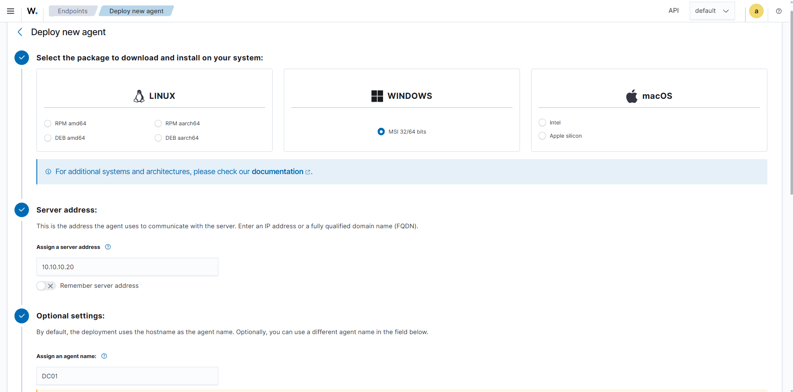

By default the agent name is the hostname, so entering it explicitly is redundant here; it matters
because the hostname is what appears in every alert, which is why the client was renamed before this
phase. Run from an elevated PowerShell on `DC01`:

```powershell
Invoke-WebRequest -Uri https://packages.wazuh.com/4.x/windows/wazuh-agent-4.14.9-1.msi -OutFile $env:tmp\wazuh-agent; msiexec.exe /i $env:tmp\wazuh-agent /q WAZUH_MANAGER='10.10.10.20' WAZUH_AGENT_NAME='DC01'
NET START Wazuh
```

`msiexec /q` installs silently, so an absence of output does not indicate failure. The download
depends on the DC resolving public names, which is the DNS forwarder configured in Phase 1.

Connectivity to the manager's event port was confirmed from the agent side:

```powershell
Test-NetConnection 10.10.10.20 -Port 1514
```

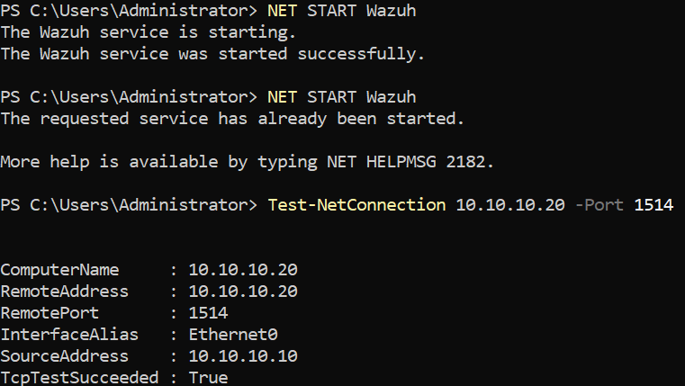

`TcpTestSucceeded : True` proves the path and the firewall rule, not enrolment — registration uses
port 1515 and happens inside the agent. The dashboard is the evidence for that:

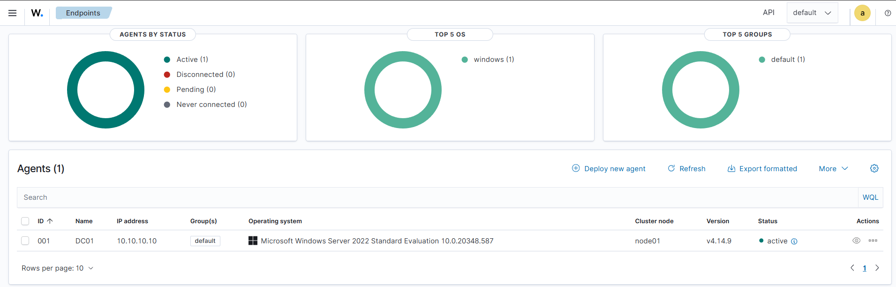

`DC01` appears as agent `001`, status **active**, in the `default` group, running agent 4.14.9.
(Agent `000` is the manager itself.) The second `NET START` returning "already been started" is
harmless; the first had succeeded.

### WIN10-CLIENT

Same procedure with the agent name `WIN10-CLIENT`, run from an elevated PowerShell on the client:

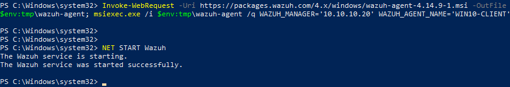

The session was a standard-user logon (`mnjah`) elevated per process through UAC, rather than an
interactive Domain Admin logon. A Domain Admin session on a workstation caches privileged credential
material in LSASS on that machine, which is the condition most credential-theft chains depend on;
elevating a single process avoids leaving it there. It also leaves explicit-credential and
special-privilege logon events (4648, 4672) on the client, a legitimate baseline for elevation that
Phase 4 detections will need to distinguish from the malicious equivalent.

Both agents are now enrolled and active:

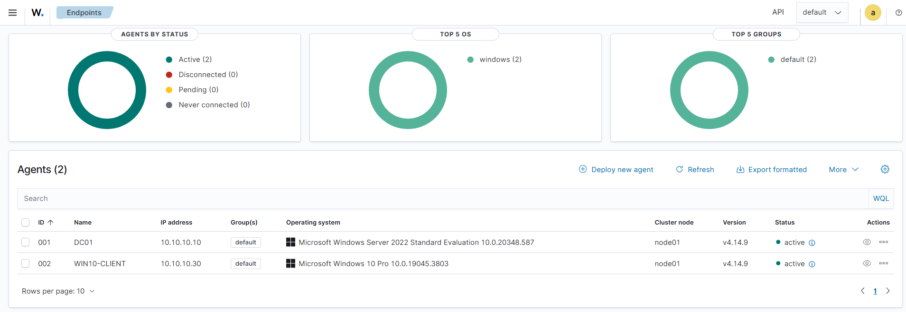

| ID | Name | Address | OS |
|---|---|---|---|
| 000 | wazuh-manager | 10.10.10.20 | Rocky Linux 10.2 (built-in local agent) |
| 001 | DC01 | 10.10.10.10 | Windows Server 2022 Standard Evaluation |
| 002 | WIN10-CLIENT | 10.10.10.30 | Windows 10 Pro 10.0.19045 |

The client reports as Windows 10 **Pro**, which is the edition required to join a domain.

## Sysmon

The Wazuh agent reads the standard Windows event logs, but those say little about process activity: no
command lines unless a second audit policy is enabled, no network connections, no file hashes, and no
record of one process opening another. Sysmon (Sysinternals System Monitor) fills that gap and is the
source for most of the process, network and credential-access detections planned for Phase 4.

Installed on `WIN10-CLIENT` first, so a problem could be isolated before touching the domain controller.

**Sources.** Sysmon from Microsoft's Sysinternals download, and the SwiftOnSecurity community
configuration (`sysmonconfig-export.xml`), a widely used, heavily commented starting point. That
repository was last updated in July 2024.

The signature was checked before running anything, and the install then ran with the configuration:

```powershell
Get-AuthenticodeSignature .\Sysmon64.exe | Format-List Status, SignerCertificate
.\Sysmon64.exe -accepteula -i .\sysmonconfig-export.xml
Get-Service Sysmon64
```

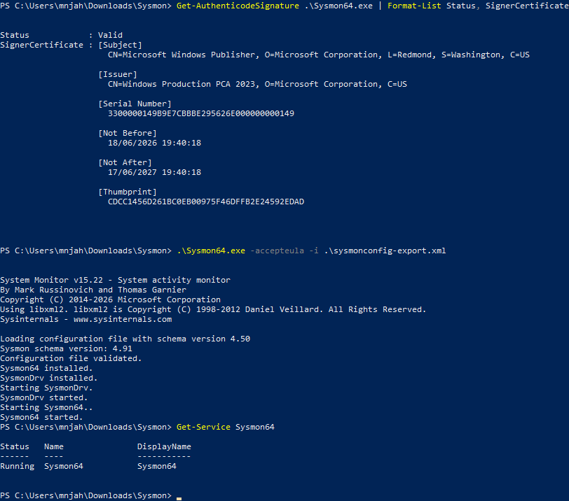

The signature is valid and issued to Microsoft Corporation; Sysmon 15.22 installed, the configuration
validated, and the `Sysmon64` service is running.

**Configuration age.** The installer reports Sysmon schema 4.91 but loaded a configuration written for
schema 4.50. Sysmon accepts it, but anything added to the schema since is outside what this config
knows to log or filter. The practical effect is a blind spot for newer events, which is the argument for
evaluating a maintained configuration such as `sysmon-modular` later.

### Telling the agent to collect it

A default 4.14.9 Windows agent does not read the Sysmon channel: searching `ossec.conf` for "Sysmon"
returned nothing, so Sysmon would have logged events that Wazuh never received. The channel was added as
an event-channel `<localfile>` entry, with the original configuration backed up first because a malformed
edit stops the agent from starting:

```xml
<localfile>
  <location>Microsoft-Windows-Sysmon/Operational</location>
  <log_format>eventchannel</log_format>
</localfile>
```

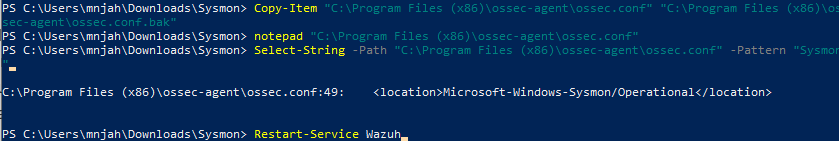

After `Restart-Service Wazuh`, filtering Threat Hunting for `WIN10-CLIENT` on
`data.win.system.providerName: Microsoft-Windows-Sysmon` returns **31 events** in the last 24 hours.

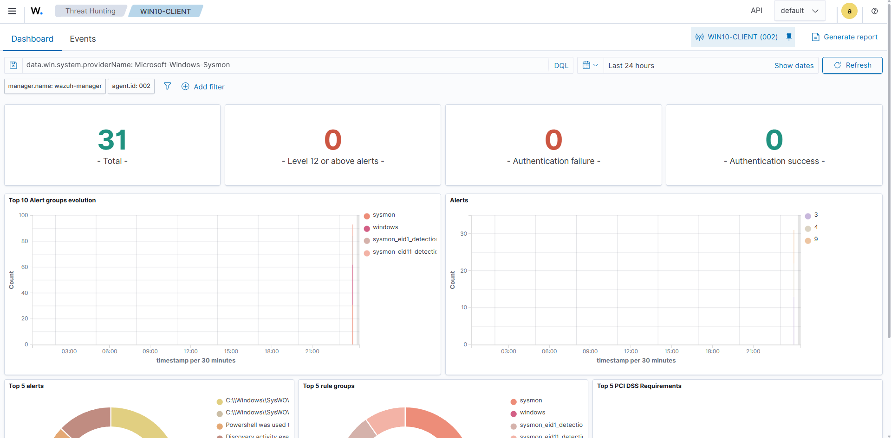

The events are decoded into Wazuh's Sysmon rule groups (`sysmon`, `sysmon_eid1_detections`,
`sysmon_eid11_detections`), meaning process-creation and file-creation events are both arriving and
matching rules. The top alert titles include a PowerShell-use rule and a discovery-activity rule; the
list is truncated in the screenshot, so the exact rules have not been recorded. None are level 12 or
above, as expected for benign activity.

## Verification still to do

- [x] Confirm the services are running: `wazuh-manager`, `wazuh-indexer`, `wazuh-dashboard`.
- [x] Check the indexer heap actually applied: it is 1024 MB, as predicted from the installer.
- [x] Open the firewall: ports 443, 1514, 1515 and 55000 over TCP.
- [x] Confirm the rules are live: `sudo firewall-cmd --list-ports`.
- [x] Reach the dashboard at `https://10.10.10.20` from the lab host and log in.
- [ ] Identify the source of the 191 alerts already present with no agents enrolled.
- [x] Check for SELinux denials (`ausearch -m avc -ts recent`) — none, with SELinux still enforcing.
- [x] Snapshot the host once the stack is confirmed healthy (`02-wazuh-installed`), giving a rollback
      point with Wazuh installed and no agents enrolled.
- [x] Enrol the agent on `DC01`.
- [x] Enrol the agent on `WIN10-CLIENT`.
- [x] Install Sysmon with a configuration on `WIN10-CLIENT` and collect its events.
- [ ] Repeat the Sysmon install and channel configuration on `DC01`.
- [ ] Record the exact rules behind the top Sysmon alerts, which the dashboard truncated.
