# Phase 2 — Wazuh SIEM/XDR build notes

Deployment of the Wazuh manager on the Rocky Linux host (`10.10.10.20`, `wazuh-manager`), followed by
agent enrolment on the Windows hosts. Addressing is in [network-plan.md](network-plan.md); the host
itself is documented in [phase-1-build-notes.md](phase-1-build-notes.md).

## Installation

Wazuh **4.14.9**, deployed all-in-one (indexer, server and dashboard on one host) using the official
installation assistant, run over SSH from the lab host with only the Rocky VM powered on — the install
has no dependency on the Windows VMs, so leaving them off kept RAM free for it.

```bash
curl -sO https://packages.wazuh.com/4.14/wazuh-install.sh
sudo bash ./wazuh-install.sh -a
```


The installer ran from 23:01:24 to 23:09:32 — about eight minutes — and finished with the dashboard
initialised and the generated `admin` credentials printed.


The generated password is deliberately redacted in the screenshot above. The installer prints it once
to the terminal, so it is recorded in a local, gitignored credentials file rather than in this
repository. Screenshots of that screen are the one place in this project where a routine documentation
habit would publish a real credential.

### Before running it

The installation assistant was read before being executed, which turned up several things worth
recording:

- **Rocky 10.2 is outside the installer's recommended list.** `check_dist` accepts `rocky` as a
  distribution but treats only 9.4 as recommended; anything else sets a flag that prints a warning and
  continues rather than aborting. The documentation's recommended-OS list covers RHEL 7–10 and CentOS
  Stream 10, so this is an untested configuration rather than an unsupported one.
- **The hardware check passes, but the lab sits below the recommendation.** The script's hard
  minimum is 2 cores and roughly 4 GB of RAM for the all-in-one install. The quickstart documentation
  recommends 4 vCPU and 8 GiB for 1–25 agents. This VM has 4 vCPU and 6 GB, which is adequate for a
  two-agent lab but short of the guidance.
- **The indexer heap is probably fixed at 1 GB.** The script derives the OpenSearch heap from a
  variable (`ram_mb`) that is never defined, so the arithmetic evaluates to zero and falls back to a
  1024 MB default regardless of the VM's memory. Inferred from reading the script, not yet observed —
  see the verification list below.

## Firewall

`firewalld` blocks everything outside its default services, so the Wazuh ports were opened explicitly:

```bash
sudo firewall-cmd --permanent --add-port={443,1514,1515,55000}/tcp && sudo firewall-cmd --reload
```


| Port | Purpose |
|---|---|
| 443/tcp | Dashboard web interface |
| 1514/tcp | Agent event traffic |
| 1515/tcp | Agent enrolment |
| 55000/tcp | Wazuh API |

firewalld keeps *runtime* and *permanent* configuration separately: `--permanent` saves a rule without
activating it, and `--reload` applies the saved set. The two `success` lines are one for each half.
The brace expansion is done by bash, not firewalld, and produces four `--add-port` arguments.

All four ports are inbound to the manager; the Windows agents connect outward and need no rules.
Port 9200 (the indexer) is deliberately left closed, since the dashboard reaches it locally.

Rules were applied to the whole `public` zone, so any host that can reach the manager can reach these
ports. Acceptable on a flat lab network; a production deployment would restrict sources to the agent
subnet with a rich rule.

## Verification

All three services report `active`:

```bash
sudo systemctl is-active wazuh-manager wazuh-indexer wazuh-dashboard
```


The dashboard is reachable at `https://10.10.10.20` from the lab host and the login succeeds. The
browser flags the connection as not secure because the installer generates a self-signed certificate;
that is expected on an isolated lab network and would be replaced with a CA-issued certificate in a
real deployment.


This confirms the stack runs on Rocky 10.2 despite the installer's recommended-OS warning, so the
untested-configuration caveat above can be treated as resolved for this version.

The overview shows **no agents registered** — as expected, none have been enrolled — yet already
reports 71 medium and 120 low severity alerts for the last 24 hours. With no agents, these are most
likely the manager monitoring itself, which Wazuh does through a built-in local agent (ID `000`). The
source has not been confirmed. It matters because it is the first baseline of "normal" noise: Phase 4
detections will need to be distinguished from it, and the Phase 5 configuration-assessment findings
will start from whatever the manager already reports about its own host.

### Post-install checks

```bash
sudo grep -E "^-Xm[sx]" /etc/wazuh-indexer/jvm.options
sudo firewall-cmd --list-ports
sudo ausearch -m avc -ts recent
```


- **Indexer heap is 1024 MB** (`-Xms1024m`, `-Xmx1024m`). This confirms the reading of the installer:
  the heap is derived from a variable that is never defined, so it falls back to a fixed 1 GB whatever
  the VM's memory. The file is root-readable only, hence `sudo` on a plain `grep`.
- **All four ports are live** at runtime, not merely saved to the permanent configuration.
- **No SELinux denials.** The system remained in enforcing mode throughout, and the install produced
  no AVC records.

The heap is left at 1 GB for now. Wazuh's tuning guidance is roughly half of system RAM, which would be
about 3 GB here, but with two agents the indexed volume is small and an unnecessary increase would
take memory from a host that is already short of it. It is the first thing to raise if the dashboard
becomes slow or the indexer logs circuit-breaker errors once Sysmon starts feeding events in.

## Agent enrolment

Agents are enrolled one host at a time, domain controller first, so that a failure on the first points
at the manager or the network rather than at anything specific to a workstation.

### DC01

The dashboard's *Deploy new agent* page generates the install command for a chosen platform, with the
manager address and agent name filled in. Settings used: Windows, MSI, server address `10.10.10.20`,
agent name `DC01`.


By default the agent name is the hostname, so entering it explicitly is redundant here; it matters
because the hostname is what appears in every alert, which is why the client was renamed before this
phase. Run from an elevated PowerShell on `DC01`:

```powershell
Invoke-WebRequest -Uri https://packages.wazuh.com/4.x/windows/wazuh-agent-4.14.9-1.msi -OutFile $env:tmp\wazuh-agent; msiexec.exe /i $env:tmp\wazuh-agent /q WAZUH_MANAGER='10.10.10.20' WAZUH_AGENT_NAME='DC01'
NET START Wazuh
```

`msiexec /q` installs silently, so an absence of output does not indicate failure. The download
depends on the DC resolving public names, which is the DNS forwarder configured in Phase 1.

Connectivity to the manager's event port was confirmed from the agent side:

```powershell
Test-NetConnection 10.10.10.20 -Port 1514
```


`TcpTestSucceeded : True` proves the path and the firewall rule, not enrolment — registration uses
port 1515 and happens inside the agent. The dashboard is the evidence for that:


`DC01` appears as agent `001`, status **active**, in the `default` group, running agent 4.14.9.
(Agent `000` is the manager itself.) The second `NET START` returning "already been started" is
harmless; the first had succeeded.

### WIN10-CLIENT

Same procedure with the agent name `WIN10-CLIENT`, run from an elevated PowerShell on the client:


The session was a standard-user logon (`mnjah`) elevated per process through UAC, rather than an
interactive Domain Admin logon. A Domain Admin session on a workstation caches privileged credential
material in LSASS on that machine, which is the condition most credential-theft chains depend on;
elevating a single process avoids leaving it there. It also leaves explicit-credential and
special-privilege logon events (4648, 4672) on the client, a legitimate baseline for elevation that
Phase 4 detections will need to distinguish from the malicious equivalent.

Both agents are now enrolled and active:


| ID | Name | Address | OS |
|---|---|---|---|
| 000 | wazuh-manager | 10.10.10.20 | Rocky Linux 10.2 (built-in local agent) |
| 001 | DC01 | 10.10.10.10 | Windows Server 2022 Standard Evaluation |
| 002 | WIN10-CLIENT | 10.10.10.30 | Windows 10 Pro 10.0.19045 |

The client reports as Windows 10 **Pro**, which is the edition required to join a domain.

## Sysmon

The Wazuh agent reads the standard Windows event logs, but those say little about process activity: no
command lines unless a second audit policy is enabled, no network connections, no file hashes, and no
record of one process opening another. Sysmon (Sysinternals System Monitor) fills that gap and is the
source for most of the process, network and credential-access detections planned for Phase 4.

Installed on `WIN10-CLIENT` first, so a problem could be isolated before touching the domain controller.

**Sources.** Sysmon from Microsoft's Sysinternals download, and the SwiftOnSecurity community
configuration (`sysmonconfig-export.xml`), a widely used, heavily commented starting point. That
repository was last updated in July 2024.

The signature was checked before running anything, and the install then ran with the configuration:

```powershell
Get-AuthenticodeSignature .\Sysmon64.exe | Format-List Status, SignerCertificate
.\Sysmon64.exe -accepteula -i .\sysmonconfig-export.xml
Get-Service Sysmon64
```


The signature is valid and issued to Microsoft Corporation; Sysmon 15.22 installed, the configuration
validated, and the `Sysmon64` service is running.

**Configuration age.** The installer reports Sysmon schema 4.91 but loaded a configuration written for
schema 4.50. Sysmon accepts it, but anything added to the schema since is outside what this config
knows to log or filter. The practical effect is a blind spot for newer events, which is the argument for
evaluating a maintained configuration such as `sysmon-modular` later.

### Telling the agent to collect it

A default 4.14.9 Windows agent does not read the Sysmon channel: searching `ossec.conf` for "Sysmon"
returned nothing, so Sysmon would have logged events that Wazuh never received. The channel was added as
an event-channel `<localfile>` entry, with the original configuration backed up first because a malformed
edit stops the agent from starting:

```xml
<localfile>
  <location>Microsoft-Windows-Sysmon/Operational</location>
  <log_format>eventchannel</log_format>
</localfile>
```


After `Restart-Service Wazuh`, filtering Threat Hunting for `WIN10-CLIENT` on
`data.win.system.providerName: Microsoft-Windows-Sysmon` returns **31 events** in the last 24 hours.


The events are decoded into Wazuh's Sysmon rule groups (`sysmon`, `sysmon_eid1_detections`,
`sysmon_eid11_detections`), meaning process-creation and file-creation events are both arriving and
matching rules. The top alert titles include a PowerShell-use rule and a discovery-activity rule; the
list is truncated in the screenshot, so the exact rules have not been recorded. None are level 12 or
above, as expected for benign activity.

### End-to-end check with a marker event

A count of Sysmon events in the dashboard shows data is arriving but not that a specific event made the
whole trip. To follow one event through each stage, a command carrying a unique string was run on the
client, so it would appear in Sysmon's recorded command line:

```powershell
cmd.exe /c "echo LABTEST7731 & whoami"
```

The first attempt used `&&`, which Windows PowerShell 5.1 does not support, so it failed at parse time
and ran nothing; the argument has to be quoted so `cmd.exe` receives the `&` itself. A run that
generates no event cannot be mistaken for a pipeline fault.

The event was then located at two points:

```powershell
Get-WinEvent -LogName "Microsoft-Windows-Sysmon/Operational" -MaxEvents 20 |
    Where-Object { $_.Message -match "LABTEST7731" } | Format-List TimeCreated, Id
```

```bash
sudo grep -c "LABTEST7731" /var/ossec/logs/alerts/alerts.json
```

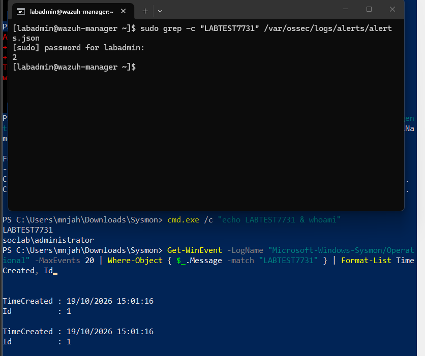

Sysmon recorded two Event ID 1 (process creation) entries containing the marker, and the manager's
`alerts.json` holds two matching alerts, so nothing was lost between the endpoint and the manager. The
second event is probably `whoami.exe`, whose parent command line also contains the marker; that has not
been inspected. Checking `alerts.json` rather than the dashboard separates the two places a failure
could occur: it is written before indexing, so an event present there but absent from the dashboard
points at the indexer rather than the agent or rules.

A caveat for interpreting absence: Wazuh stores only events that match a rule at alert level 3 or
above. A delivered event that matches no rule never reaches the dashboard, so a missing event does not
by itself prove it was not delivered. Raw archiving (`logall_json`) settles that question when needed,
at the cost of logging every event.

The final hop, the dashboard, was checked with a search on the command-line field:

```
data.win.eventdata.commandLine: *LABTEST7731*
```

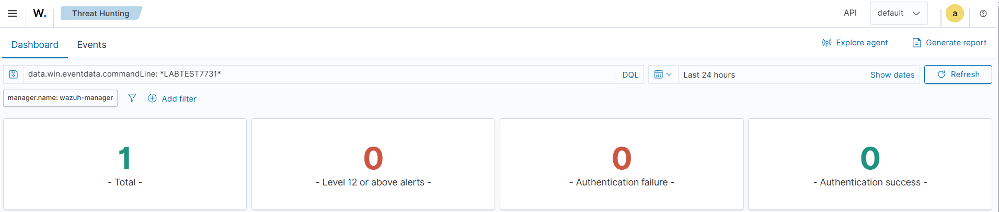

It returns **one** match, so the event is indexed and searchable end to end. That is one fewer than the two
alerts in `alerts.json`, which fits the earlier reading: this query covers only the `commandLine` field,
and the `whoami.exe` event would carry the marker in `parentCommandLine`, a separate field. Neither event
has been opened to confirm it.

The `whoami` output in the same session returned `soclab\administrator`: the shell used for the Sysmon
install is elevated with the domain account while the logon session remains the standard user, which
confirms the per-process elevation described above.

### Sysmon on DC01

Repeated on the domain controller once the client was proven, with the same binary, the same
configuration and the same channel entry in the agent's `ossec.conf`.

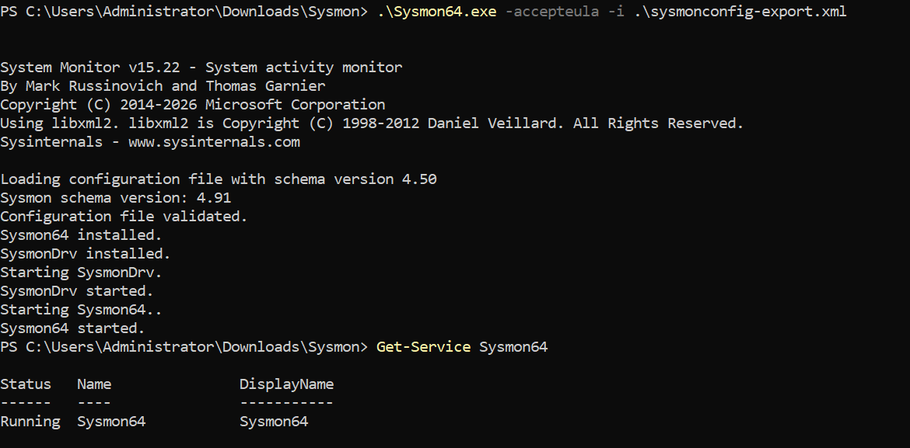

Sysmon 15.22 installed with the configuration validated (again schema 4.50 against Sysmon's 4.91) and
`Sysmon64` is running. A domain controller is the more valuable of the two sources, since it records
the Kerberos, LDAP and account activity that most of the Phase 4 attack techniques target, and a
process-level view of what runs on it.

The signature of this copy was checked after the install:

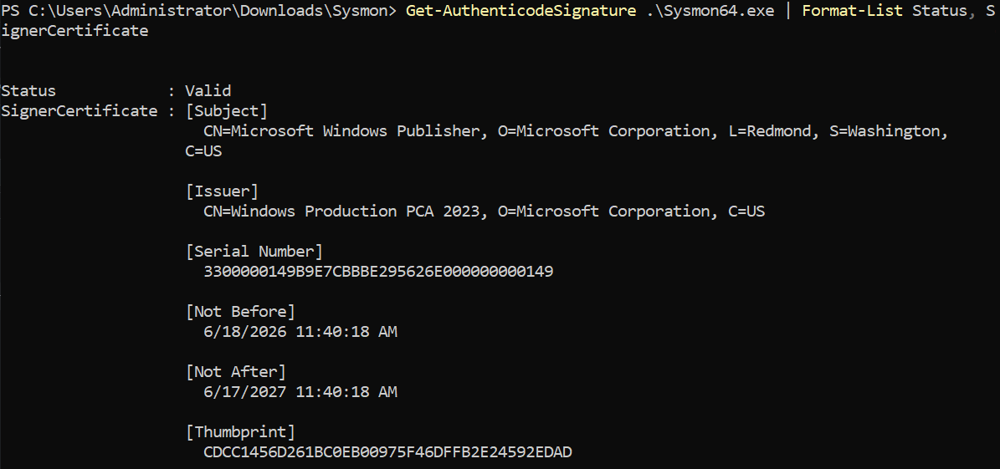

It is valid and issued to Microsoft, and the certificate thumbprint matches the client's copy, so both
hosts run the same signed binary.

The same marker method was used with a different string, so events from the two hosts cannot be confused:

```powershell
cmd.exe /c "echo LABTEST9942 & whoami"
```

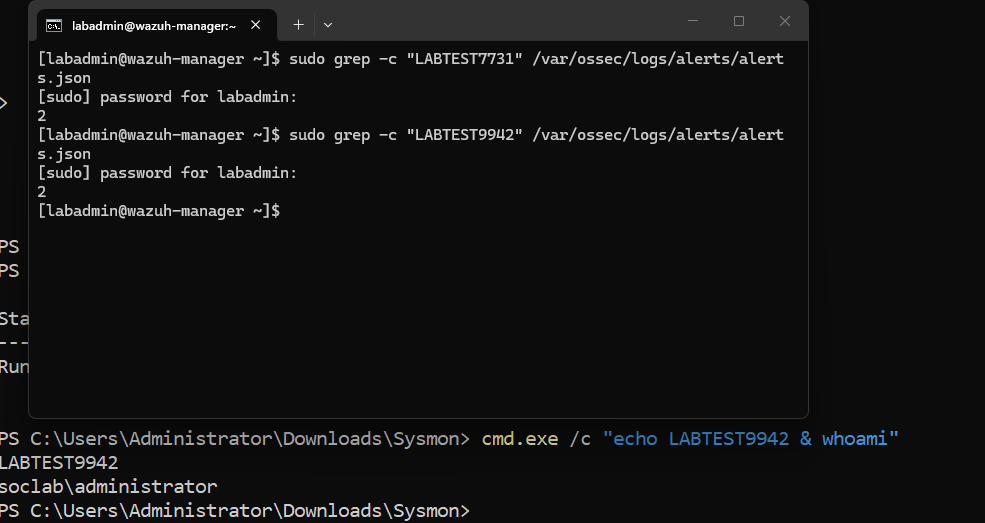

The manager's `alerts.json` holds two entries for `LABTEST9942`, and the earlier client marker still
reports two, so the second host did not disturb the first. The dashboard search on the command-line
field finds one match, matching the client's pattern:

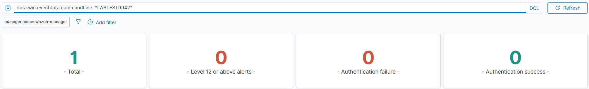

The dashboard query is not scoped to an agent; the match is attributed to `DC01` because the marker was
only ever executed there. The `whoami` output again reads `soclab\administrator`.

## Windows Security log

Sysmon is a separate channel, so the standard Security log was checked on its own. A failed logon for a
non-existent local account, with a unique name so it could be traced, was generated on the client:

```powershell
runas /user:labtest9001 cmd.exe
```

It fails with error 1326 (*the user name or password is incorrect*), which writes a Security logon-failure
event (4625). The manager's `alerts.json` then holds one entry for the marker:

```bash
sudo grep -c "labtest9001" /var/ossec/logs/alerts/alerts.json
```

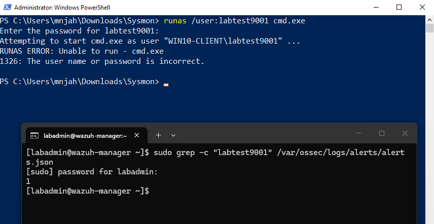

In the dashboard, searching `data.win.eventdata.targetUserName: labtest9001` for `WIN10-CLIENT` returns one
event, which Wazuh counts under **Authentication failure**:

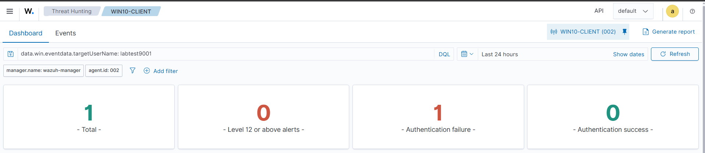

That the dashboard classifies it as an authentication failure, rather than merely storing it, shows the
Security events are being decoded and matched to rules. The default agent configuration collects this
channel, so no change was needed, unlike Sysmon. Failed-logon events are the basis of the brute-force
detection planned for Phase 4, where the domain controller is the more interesting source, since failed
domain authentications are recorded there.

## Linux auditd on the manager

The Linux side of "logs flowing" was checked on the manager itself, which monitors its own host through
the built-in local agent.

`auditd` was running, and the manager's `ossec.conf` already contains a `<localfile>` with
`log_format audit` for `/var/log/audit/audit.log`, so unlike Sysmon no collection change was needed.

**`auditctl` was missing.** On Rocky 10 the audit tooling is split: `auditd` and `ausearch` ship in
`audit`, but `auditctl`, the tool that loads watch rules, comes from a separate `audit-rules` package
(`audit-rules-4.0.3-5.el10`). It was not part of the minimal install. Installing it was a change to the
host: its install script loaded the package's default audit rules and printed audit status several times,
which looked like noise but was rules being activated. This should be accounted for in the Phase 5 baseline
for this host.

**Wazuh alerts on audit keys, not on every record.** `ossec.conf` references a list of audit keys
(`/var/ossec/etc/lists/audit-keys`): `audit-wazuh-w` (write), `-r` (read), `-a` (attribute), `-x` (execute)
and `-c` (command). A watch with some other key is logged by auditd and read by the agent but produces no
alert. This was demonstrated in two steps.

First, a watch with an arbitrary key was logged correctly by auditd, but is not in the list:

```bash
sudo auditctl -w /tmp/labtest_audit -p w -k labtest_audit
touch /tmp/labtest_audit
sudo ausearch -k labtest_audit
```

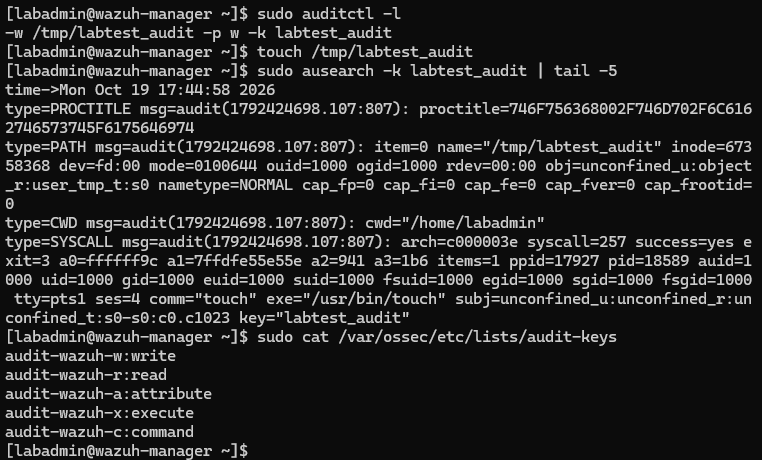

`ausearch` returns the full record chain: `PATH` naming the file, `SYSCALL` identifying
`/usr/bin/touch` run by the logged-in user, and the key. The watch was then removed and replaced with one
using a key from the list, on a new filename:

```bash
sudo auditctl -w /tmp/labtest_wazuh_w -p w -k audit-wazuh-w
touch /tmp/labtest_wazuh_w
sudo grep -c "labtest_wazuh_w" /var/ossec/logs/alerts/alerts.json
```

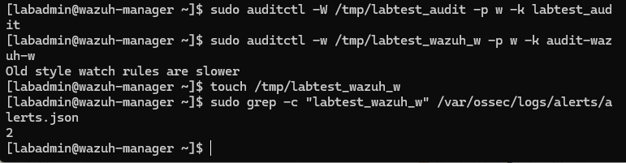

The manager's `alerts.json` holds two entries, so the event travelled from auditd through Wazuh's audit
decoder and produced alerts. The watches are runtime-only and disappear on reboot, so nothing persistent
was added beyond the `audit-rules` package.

The event is also searchable in the dashboard, on the audit decoder's own field names:

```
data.audit.file.name: *labtest_wazuh_w*
```

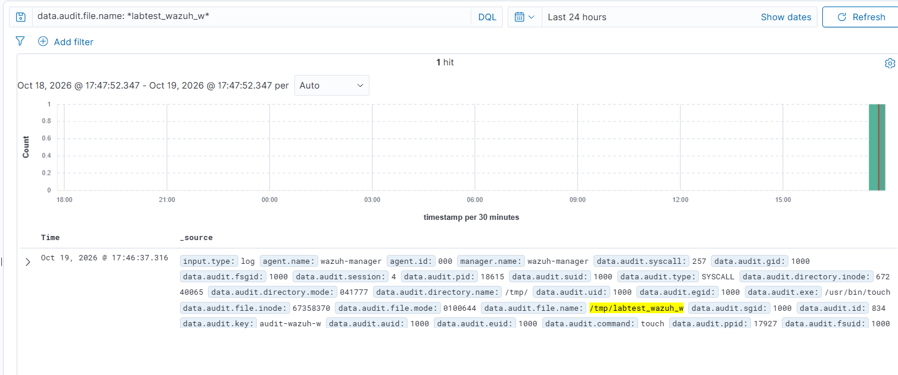

It returns one hit from agent `000` (the manager), carrying `data.audit.key: audit-wazuh-w`, the file name
`/tmp/labtest_wazuh_w`, `data.audit.exe: /usr/bin/touch`, the command `touch`, record type `SYSCALL`, and
the audit user ID of the account that ran it. That is the useful part of auditd telemetry: who ran what,
against which file, tied to the original login session.

The dashboard shows one hit against two entries in `alerts.json`. The second entry most likely lacks the
`file.name` field this search matches, for instance a different audit record type from the same event, but
it has not been opened to confirm. Because the search keys on a specific field, a count for one field does
not account for every alert, which is the same lesson as the Sysmon marker's `commandLine` search.

The practical consequence for later phases: Linux audit detections only exist where a rule is tagged with
one of these keys, so any auditd-based detection in Phase 4 or 5 must use them.

## First high-severity alerts: both benign

Filtering the dashboard to `rule.level: 15 and above` returned two alerts in the first day, both mapped
to MITRE *Ingress Tool Transfer* (T1105). Level 15 is the top of Wazuh's scale, so they were opened
rather than assumed to be noise.

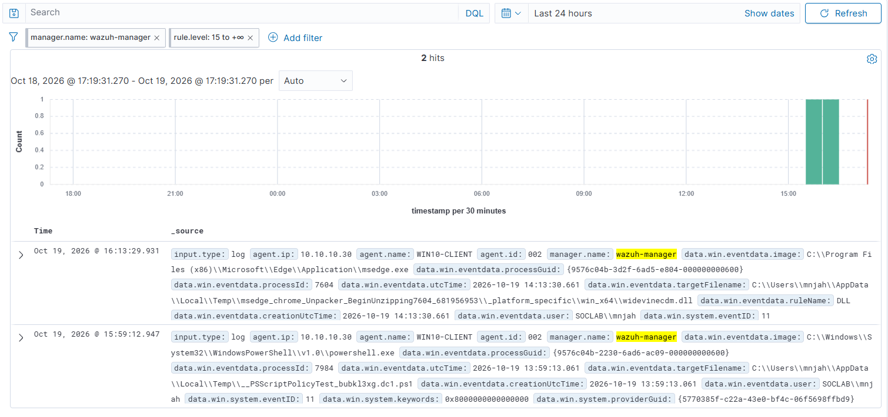

Both are Sysmon **Event ID 11 (file creation)** from `WIN10-CLIENT` (agent `002`), user `SOCLAB\mnjah`:

| Time (local) | Process | File created |
|---|---|---|
| 15:59:12 | `powershell.exe` | `...\AppData\Local\Temp\__PSScriptPolicyTest_*.ps1` |
| 16:13:29 | `msedge.exe` | `...\AppData\Local\Temp\msedge_chrome_Unpacker_...\widevinecdm.dll` |

- The first is a file PowerShell writes itself, briefly, to test whether scripts can run under the
  current execution policy. It appears whenever an elevated or policy-checked PowerShell session starts.
- The second is Microsoft Edge's component updater unpacking a browser component, the Widevine DRM
  module, into a temporary folder.

Neither is malicious. Both are an executable or script created by a normal process in a user-writable
temporary directory, which is exactly the pattern the rule exists to catch, because attackers drop
payloads in the same places. Severity reflects how suspicious the *pattern* is, not whether the event is
hostile, and nothing here distinguishes the benign case from the malicious one except the process and
file name.

The first guess about these alerts, that they came from the Sysmon downloads on the domain controller,
was wrong: they are on the client and unrelated to that activity. The cause was identified by reading the
event fields rather than inferred from timing.

Two practical consequences for Phase 4:

- **Severity alone is a poor alert threshold here.** Ordinary browser and PowerShell behaviour reaches
  level 15, while most Sysmon events sit at level 3. A detection that fires on level alone would page on
  routine activity.
- **These are the first false-positive and tuning candidates.** Any detection card for dropped
  executables needs a known-benign section listing these two patterns, and a tuning note on narrowing
  the rule by parent process or path.

Both alerts are rule **92213**, *"Executable file dropped in folder commonly used by malware"*, level 15,
MITRE T1105. Its definition in the 4.14.9 ruleset (`0830-sysmon_id_11.xml`) is simple: it fires on any
Sysmon Event ID 11 whose `targetFilename` matches `...\Users\<user>\AppData\Local\Temp\<anything>` with
an extension of `exe`, `com`, `dll`, `vbs`, `js`, `bat`, `cmd`, `pif`, `wsh`, `ps1`, `msi` or `vbe`.

The rule has **no condition on the creating process**. The path and the extension alone are enough, so
any browser, installer or PowerShell session that writes one of those file types to Temp reaches level 15,
which explains why two ordinary events scored at the top of the scale. It is a reasonable catch-all for
payload drops and a poor discriminator.

A tuning option, not applied: a local child rule that matches 92213 and lowers the level when the image
is a known-benign updater, leaving the rule at level 15 for everything else. Writing it, and checking it
still fires on a real drop, belongs with the Phase 4 detection card.

The dashboard's time column is local time, while Sysmon's own `utcTime` field is UTC, so they differ by
two hours (14:13 UTC is 16:13 local). That offset matters when matching events across the two.

## Verification still to do

- [x] Confirm the services are running: `wazuh-manager`, `wazuh-indexer`, `wazuh-dashboard`.
- [x] Check the indexer heap actually applied: it is 1024 MB, as predicted from the installer.
- [x] Open the firewall: ports 443, 1514, 1515 and 55000 over TCP.
- [x] Confirm the rules are live: `sudo firewall-cmd --list-ports`.
- [x] Reach the dashboard at `https://10.10.10.20` from the lab host and log in.
- [ ] Identify the source of the 191 alerts already present with no agents enrolled.
- [x] Check for SELinux denials (`ausearch -m avc -ts recent`) — none, with SELinux still enforcing.
- [x] Snapshot the host once the stack is confirmed healthy (`02-wazuh-installed`), giving a rollback
      point with Wazuh installed and no agents enrolled.
- [x] Enrol the agent on `DC01`.
- [x] Enrol the agent on `WIN10-CLIENT`.
- [x] Install Sysmon with a configuration on `WIN10-CLIENT` and collect its events.
- [x] Confirm a marker event travels from Sysmon to the manager's `alerts.json`.
- [x] Confirm the same marker is searchable in the dashboard (`data.win.eventdata.commandLine`).
- [x] Repeat the Sysmon install and channel configuration on `DC01`, with a marker test.
- [x] Verify the signature of the `Sysmon64.exe` copy used on `DC01`.
- [x] Note the dashboard's responsiveness now that the domain controller is feeding events: it remains
      responsive with both hosts reporting, so the default 1 GB indexer heap is adequate at this volume.
- [x] Confirm Windows Security events reach Wazuh, using a failed logon marker (`labtest9001`).
- [x] Check Linux `auditd` on the manager: it runs, Wazuh reads its log, and a keyed event reaches
      `alerts.json`. Required installing `audit-rules` for `auditctl`.
- [x] Snapshot both Windows VMs once the agent and Sysmon were configured and verified, giving a
      rollback point before any attack simulation.
- [x] Capture the SCA baseline for both Windows hosts before hardening — see
      [../hardening/baseline.md](../hardening/baseline.md): `DC01` 27%, `WIN10-CLIENT` 28%.
- [x] Investigate the two level-15 alerts mapped to Ingress Tool Transfer (T1105): benign, from the
      client — a PowerShell script-policy test file and an Edge component unpack.
- [x] Record the rule behind those two alerts: 92213, checked against the 4.14.9 ruleset.
- [ ] Record the exact rules behind the top Sysmon alerts, which the dashboard truncated.
