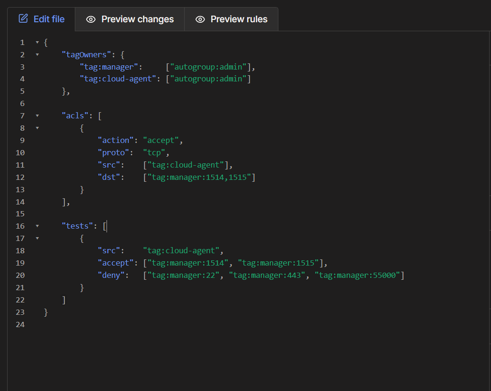
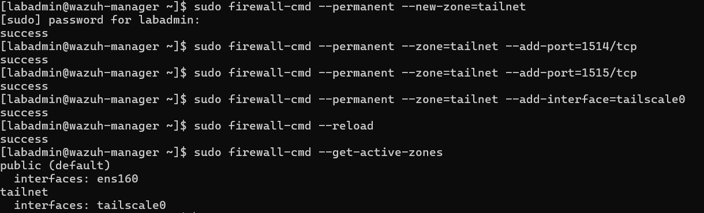

# Phase 3 — Cloud node build notes

Extends the lab with a cloud VM that reports to the on-premises Wazuh manager. The provider is **AWS**
(Free plan) and the link is a **Tailscale** mesh VPN; both choices and the rejected alternatives are in
[decisions.md](decisions.md), and the connectivity design is in [network-plan.md](network-plan.md).

## Tailscale on the manager

Tailscale is installed on the Rocky manager itself, so the tunnel terminates where the service runs,
rather than on the laptop. The repository definition was read before use: HTTPS, with both package and
repository signature checking enabled, and the signing key served from the same host.

```bash
sudo curl -fsSL https://pkgs.tailscale.com/stable/rhel/10/tailscale.repo -o /etc/yum.repos.d/tailscale.repo
sudo dnf install -y tailscale
sudo systemctl enable --now tailscaled
sudo tailscale up --accept-dns=false
```

The repo file was fetched directly rather than through `dnf config-manager`, which depends on a plugin that
a minimal install may not have.


The signing key was imported and the transaction checks passed. Tailscale 1.104.4 installed, along with
`iptables-nft` as a dependency. The login URL printed by `tailscale up` is a one-time link tying the machine
to an account, so it is redacted in the screenshot.

**`--accept-dns=false`.** On Linux, Tailscale by default takes over DNS configuration. That would risk
overwriting the resolver arrangement verified in Phase 1 (the domain controller first, the NAT gateway as
fallback), and this host does not need Tailscale's name resolution.

The manager received the tunnel address `100.73.251.78`. Tailscale's `100.64.0.0/10` range overlaps none of
the lab network, AWS's default VPC range, or Azure's.


The admin console shows the manager connected. Account email, device ID, node key, tailnet domain and
external endpoints are redacted. The page reports key expiry **six months from now**: untagged devices carry
the default expiry, so without action the manager would silently drop off the network after that period.
Tagging it was expected to remove that; see the result under *Access policy* below, which did not bear
that expectation out.

## Access policy

Tailscale's default policy lets every device reach every other on every port. The cloud VM is the
internet-facing, less-trusted machine and the manager is the one that matters most, so the default is
replaced with a single permission. The file is versioned as [../cloud/tailscale-policy.json](../cloud/tailscale-policy.json);
it holds tags and ports only, nothing secret.



- **Tags** (`tag:manager`, `tag:cloud-agent`) label machines by role rather than by owner, so the rule
  survives rebuilding the cloud VM: a replacement with the same tag is covered without editing the policy.
  Tagged machines also authenticate with a pre-made key rather than a person's login, which suits servers.
- **One rule.** Machines tagged `cloud-agent` may open TCP connections to machines tagged `manager` on
  1514 (agent events) and 1515 (enrolment), and nothing else. Policy is default-deny, so SSH, the dashboard
  and the API are unreachable from the tunnel. Rules are stateful, so replies need no reverse rule.
- **Tests.** The policy carries assertions that the two Wazuh ports are allowed and that 22, 443 and 55000
  are denied. The console evaluates them on save and refuses a policy that contradicts them, and they
  re-run on every later edit, which guards against a typo opening something by accident.

This cannot lock out administration: the policy is managed through the account in the browser, and the
manager is reached over SSH on the lab network rather than the tunnel.

The manager was then tagged:

```bash
sudo tailscale up --accept-dns=false --advertise-tags=tag:manager
```

`tailscale up` requires every non-default flag to be restated, which is why `--accept-dns=false` appears
again. The command returned without error.

The console confirms it:


The machine now carries `tag:manager`, and "Managed by" has changed from a user account to the tag. A tag
can only be applied if the policy defines it, so the policy saved; and the console only saves a policy
whose tests pass, so the tests passed.

**Key expiry did not change.** The page still reports expiry six months from now. The assumption that
tagging disables expiry was wrong for this device, which was tagged after it had already joined; whether
that holds for devices that join with a tag already attached has not been checked. The manager therefore
still needs expiry disabled explicitly, or it will drop off the network when the key lapses.

## Host firewall on the tunnel interface

The tunnel interface was placed in its own `firewalld` zone, so tunnel traffic is limited to the two Wazuh
ports by the host as well as by the Tailscale policy. Without it, `tailscale0` would land in the same zone
as the lab interface and inherit everything open there, including the dashboard and the API:

```bash
sudo firewall-cmd --permanent --new-zone=tailnet
sudo firewall-cmd --permanent --zone=tailnet --add-port=1514/tcp
sudo firewall-cmd --permanent --zone=tailnet --add-port=1515/tcp
sudo firewall-cmd --permanent --zone=tailnet --add-interface=tailscale0
sudo firewall-cmd --reload
sudo firewall-cmd --get-active-zones
```



`ens160` stays in `public` and `tailscale0` is in `tailnet`. The lab is unaffected: the Windows agents
arrive on `ens160`, and Tailscale's own encrypted packets also arrive there rather than on `tailscale0`.

### Does Tailscale's own firewall bypass the zone?

On Linux, Tailscale installs its own rules. Inspecting them showed the concern was real in part: the
`ts-input` chain, which the `INPUT` hook jumps to, contains

```
iifname "tailscale0" counter accept
ip saddr 100.64.0.0/10 iifname != "tailscale0" counter drop
```

The first accepts anything arriving on the tunnel interface. The second drops packets claiming a tailnet
source address on any other interface, an anti-spoofing rule that would be lost if Tailscale's firewall
handling were switched off (`--netfilter-mode=off`), which is a reason not to.

The first reading was that the accept rule would let tunnel traffic skip `firewalld`. That was too strong.
Tailscale's rules live in the `ip filter` table managed by `iptables-nft`, while `firewalld` keeps its
rules in a separate nftables table. In nftables an accept in one table does not stop other tables'
chains on the same hook from evaluating the packet; each registered base chain runs in priority order and
a drop or reject from any of them is final. What matters is the ordering, and it was checked:

```bash
sudo nft list table inet firewalld | grep -n -E "hook input"
# type filter hook input priority filter + 10; policy accept;
```

`firewalld`'s input chain runs at `priority filter + 10`, after Tailscale's chain at `filter`, so tunnel
traffic still passes through the `tailnet` zone's two-port limit.

That is established from the rule ordering and nftables semantics, not yet from a live test. The layers are:

1. **Tailscale policy**, enforced inside `tailscaled`: only the cloud agent, only TCP 1514 and 1515.
2. **`firewalld` `tailnet` zone**: only TCP 1514 and 1515 on the tunnel interface.
3. **Tailscale's anti-spoof rule**, dropping tailnet-sourced packets from other interfaces.

## Background: firewalld zones and the `tailscale0` interface

**Zones.** A `firewalld` zone is a named rule set describing how far to trust a network connection:
which services and ports are open, and what happens to everything else. Each interface (or source
address) is assigned to one zone, and incoming traffic is judged by the rules of the zone it arrived
through. A packet is matched to a zone by source address first, then by incoming interface, then falls
back to the default zone (`public`). Zone rules govern **incoming** connections only; connections the host
starts are allowed, and their replies are let back in by connection tracking. Configuration exists twice,
live and saved: `--permanent` writes the saved copy and `--reload` makes it live.

**The tunnel interface.** `tailscale0` is not a network card. It is a TUN interface, a software-only
interface created by `tailscaled`, with no hardware or virtual card behind it. A packet addressed to a
`100.x.y.z` peer is routed into it, `tailscaled` reads it, encrypts it with WireGuard and wraps it in an
ordinary UDP packet, and that packet leaves through the real interface, `ens160`, across the NAT and the
internet to the peer, where the process reverses.

```
 program ──▶ tailscale0 ──▶ tailscaled (encrypt) ──▶ ens160 ──▶ NAT ──▶ internet ──▶ peer
 100.x.y.z    software        WireGuard in UDP       real path
```

The manager therefore has two interfaces with two addresses and two zones: `ens160` (`10.10.10.20`, zone
`public`) carries the lab and the tunnel's encrypted packets, and `tailscale0` (`100.73.251.78`, zone
`tailnet`) carries the decrypted Wazuh traffic from the cloud VM. That is why the two zones govern
different things even though everything ultimately travels over one network card.

## Still to do

- [x] Confirm `/etc/resolv.conf` still lists the two original nameservers after `tailscale up`: it lists
      the domain controller first and the NAT gateway second, so `--accept-dns=false` left DNS alone.
- [x] Write the access policy (tags `tag:manager` and `tag:cloud-agent`; the cloud VM may reach the manager
      on TCP 1514 and 1515 only); it saved, so its built-in tests passed.
- [x] Re-run `tailscale up` with `--advertise-tags=tag:manager`; the tag is applied in the console.
- [x] Disable key expiry for the manager in the console (done; the resulting page was not captured).
- [x] Put `tailscale0` in its own `firewalld` zone allowing only TCP 1514 and 1515, and check that
      `firewalld` still evaluates tunnel traffic after Tailscale's rules.
- [ ] Prove the `firewalld` layer on its own once the cloud VM exists: temporarily widen the Tailscale
      policy to allow all ports from it, confirm 22 and 443 are still refused, then restore the policy.
- [ ] Confirm multi-factor authentication is on for the Tailscale identity provider and the AWS root user.
- [ ] AWS guardrails (budget, no public SSH or RDP, testing policy) before any resource is created.
- [ ] Launch the cloud VM, join it to Tailscale as `tag:cloud-agent`, and enrol its Wazuh agent against the
      manager's tunnel address.
- [ ] Ship CloudTrail into Wazuh, then run the deliberate misconfiguration demo.
