# Phase 3 — Cloud node build notes

Extends the lab with a cloud VM that reports to the on-premises Wazuh manager. The provider is **Google
Cloud (GCP)** on its Free Trial and the link is a **Tailscale** mesh VPN; both choices and the rejected
alternatives are in [decisions.md](decisions.md), and the connectivity design is in
[network-plan.md](network-plan.md). AWS was the original choice and was dropped when the account turned out
not to be eligible for its free plan; the decisions log has the full account.

## Summary (phase closed 15 November 2026)

**What was achieved.** A Rocky Linux 10 VM on Google Cloud, `gcp-node01`, is enrolled as a password-protected
Wazuh agent and reports to the on-premises manager through a Tailscale tunnel. Two controls on the manager's
side of the tunnel (the Tailscale access policy and a `firewalld` zone) were tested both together and
separately. The cloud VM's own host firewall was found wide open, and fixed. Cloud Audit Logs reach Wazuh
through a log sink and Pub/Sub, a custom rule (100500) detects a firewall rule opened to the internet, and the
demo created, detected and fixed one. The first custom detection card and a pre-hardening CIS baseline for
the cloud node were written.

## Tailscale on the manager

Tailscale is installed on the Rocky manager itself, so the tunnel terminates where the service runs,
rather than on the laptop. The repository definition was read before use: HTTPS, with both package and
repository signature checking enabled, and the signing key served from the same host.

```bash
sudo curl -fsSL https://pkgs.tailscale.com/stable/rhel/10/tailscale.repo -o /etc/yum.repos.d/tailscale.repo
sudo dnf install -y tailscale
sudo systemctl enable --now tailscaled
sudo tailscale up --accept-dns=false
```

The repo file was fetched directly rather than through `dnf config-manager`, which depends on a plugin that
a minimal install may not have.


The signing key was imported and the transaction checks passed. Tailscale 1.104.4 installed, along with
`iptables-nft` as a dependency. The login URL printed by `tailscale up` is a one-time link tying the machine
to an account, so it is redacted in the screenshot.

**`--accept-dns=false`.** On Linux, Tailscale by default takes over DNS configuration. That would risk
overwriting the resolver arrangement verified in Phase 1 (the domain controller first, the NAT gateway as
fallback), and this host does not need Tailscale's name resolution.

The manager received the tunnel address `100.73.251.78`. Tailscale's `100.64.0.0/10` range overlaps none of
the lab network or the AWS and Azure default ranges. GCP's default network ranges have not yet been checked
against the lab and the tunnel range; that check belongs with creating the project's network.


The admin console shows the manager connected. Account email, device ID, node key, tailnet domain and
external endpoints are redacted. The page reports key expiry **six months from now**: untagged devices carry
the default expiry, so without action the manager would silently drop off the network after that period.
Tagging it was expected to remove that; see the result under *Access policy* below, which did not bear
that expectation out.

## Access policy

Tailscale's default policy lets every device reach every other on every port. The cloud VM is the
internet-facing, less-trusted machine and the manager is the one that matters most, so the default is
replaced with a single permission. The file is versioned as [../cloud/tailscale-policy.json](../cloud/tailscale-policy.json);
it holds tags and ports only, nothing secret.


- **Tags** (`tag:manager`, `tag:cloud-agent`) label machines by role rather than by owner, so the rule
  survives rebuilding the cloud VM: a replacement with the same tag is covered without editing the policy.
  Tagged machines also authenticate with a pre-made key rather than a person's login, which suits servers.
- **One rule.** Machines tagged `cloud-agent` may open TCP connections to machines tagged `manager` on
  1514 (agent events) and 1515 (enrolment), and nothing else. Policy is default-deny, so SSH, the dashboard
  and the API are unreachable from the tunnel. Rules are stateful, so replies need no reverse rule.
- **Tests.** The policy carries assertions that the two Wazuh ports are allowed and that 22, 443 and 55000
  are denied. The console evaluates them on save and refuses a policy that contradicts them, and they
  re-run on every later edit, which guards against a typo opening something by accident.

This cannot lock out administration: the policy is managed through the account in the browser, and the
manager is reached over SSH on the lab network rather than the tunnel.

The manager was then tagged:

```bash
sudo tailscale up --accept-dns=false --advertise-tags=tag:manager
```

`tailscale up` requires every non-default flag to be restated, which is why `--accept-dns=false` appears
again. The command returned without error.

The console confirms it:


The machine now carries `tag:manager`, and "Managed by" has changed from a user account to the tag. A tag
can only be applied if the policy defines it, so the policy saved; and the console only saves a policy
whose tests pass, so the tests passed.

**Key expiry did not change.** The page still reports expiry six months from now. The assumption that
tagging disables expiry was wrong for this device, which was tagged after it had already joined; whether
that holds for devices that join with a tag already attached has not been checked. The manager therefore
still needs expiry disabled explicitly, or it will drop off the network when the key lapses.

## Host firewall on the tunnel interface

The tunnel interface was placed in its own `firewalld` zone, so tunnel traffic is limited to the two Wazuh
ports by the host as well as by the Tailscale policy. The expectation was that, without a zone of its own,
`tailscale0` would fall into the default `public` zone and inherit everything open there, including the
dashboard and the API. **That was not checked beforehand**: the zone state was not captured before the
change, and the only earlier baseline predates the Tailscale install, so it could not show the interface at
all. The commands were additive and reversible and did not touch the lab interface, so the risk was low,
but the starting state should have been recorded first (`firewall-cmd --get-active-zones` and
`--list-all-zones`):

```bash
sudo firewall-cmd --permanent --new-zone=tailnet
sudo firewall-cmd --permanent --zone=tailnet --add-port=1514/tcp
sudo firewall-cmd --permanent --zone=tailnet --add-port=1515/tcp
sudo firewall-cmd --permanent --zone=tailnet --add-interface=tailscale0
sudo firewall-cmd --reload
sudo firewall-cmd --get-active-zones
```


`ens160` stays in `public` and `tailscale0` is in `tailnet`. The lab is unaffected: the Windows agents
arrive on `ens160`, and Tailscale's own encrypted packets also arrive there rather than on `tailscale0`.

### Does Tailscale's own firewall bypass the zone?

On Linux, Tailscale installs its own rules. Inspecting them showed the concern was real in part: the
`ts-input` chain, which the `INPUT` hook jumps to, contains

```
iifname "tailscale0" counter accept
ip saddr 100.64.0.0/10 iifname != "tailscale0" counter drop
```

The first accepts anything arriving on the tunnel interface. The second drops packets claiming a tailnet
source address on any other interface, an anti-spoofing rule that would be lost if Tailscale's firewall
handling were switched off (`--netfilter-mode=off`), which is a reason not to.

The first reading was that the accept rule would let tunnel traffic skip `firewalld`. That was too strong.
Tailscale's rules live in the `ip filter` table managed by `iptables-nft`, while `firewalld` keeps its
rules in a separate nftables table. In nftables an accept in one table does not stop other tables'
chains on the same hook from evaluating the packet; each registered base chain runs in priority order and
a drop or reject from any of them is final. What matters is the ordering, and it was checked:

```bash
sudo nft list table inet firewalld | grep -n -E "hook input"
# type filter hook input priority filter + 10; policy accept;
```

`firewalld`'s input chain runs at `priority filter + 10`, after Tailscale's chain at `filter`, so tunnel
traffic still passes through the `tailnet` zone's two-port limit.

That is established from the rule ordering and nftables semantics, not yet from a live test. The layers are:

1. **Tailscale policy**, enforced inside `tailscaled`: only the cloud agent, only TCP 1514 and 1515.
2. **`firewalld` `tailnet` zone**: only TCP 1514 and 1515 on the tunnel interface.
3. **Tailscale's anti-spoof rule**, dropping tailnet-sourced packets from other interfaces.

## Background: firewalld zones and the `tailscale0` interface

**Zones.** A `firewalld` zone is a named rule set describing how far to trust a network connection:
which services and ports are open, and what happens to everything else. Each interface (or source
address) is assigned to one zone, and incoming traffic is judged by the rules of the zone it arrived
through. A packet is matched to a zone by source address first, then by incoming interface, then falls
back to the default zone (`public`). Zone rules govern **incoming** connections only; connections the host
starts are allowed, and their replies are let back in by connection tracking. Configuration exists twice,
live and saved: `--permanent` writes the saved copy and `--reload` makes it live.

**The tunnel interface.** `tailscale0` is not a network card. It is a TUN interface, a software-only
interface created by `tailscaled`, with no hardware or virtual card behind it. A packet addressed to a
`100.x.y.z` peer is routed into it, `tailscaled` reads it, encrypts it with WireGuard and wraps it in an
ordinary UDP packet, and that packet leaves through the real interface, `ens160`, across the NAT and the
internet to the peer, where the process reverses.

```
 program ──▶ tailscale0 ──▶ tailscaled (encrypt) ──▶ ens160 ──▶ NAT ──▶ internet ──▶ peer
 100.x.y.z    software        WireGuard in UDP       real path
```

The manager therefore has two interfaces with two addresses and two zones: `ens160` (`10.10.10.20`, zone
`public`) carries the lab and the tunnel's encrypted packets, and `tailscale0` (`100.73.251.78`, zone
`tailnet`) carries the decrypted Wazuh traffic from the cloud VM. That is why the two zones govern
different things even though everything ultimately travels over one network card.

## GCP: cost guardrail

The cloud provider is Google Cloud on its Free Trial: a $300 welcome credit (shown as €269) valid for 90
days, expiring 1 February 2027. Google states there are no automatic charges, so spending can only begin
if the billing account is upgraded by hand; the Upgrade button is never used. A budget is still set as a
backstop and a way to watch consumption.


`lab-budget`: monthly, €10, alerts at 50%, 90% and 100% of actual spend, emailed to the billing
administrators. "Spend cap status: not applicable" confirms it is an alert and stops nothing.

**The default would have made it useless.** Google's documentation says that when a budget is created, all
*Savings* types are selected by default, and that actual spend is then calculated as total cost **minus**
discounts and credits. A promotional credit is one of those. During the trial the credit covers everything,
so the calculated spend stays at zero and the budget never fires. To monitor spend before credits, none of
the Savings options may be selected, and they were all cleared. The row's "No credits used" is consistent
with that, but the scope screen is the authoritative place to check it.

Limits to remember: billing data lags by hours, so an alert can arrive after the spend, and the budget
cannot prevent anything. The trial's own behaviour is the real protection.

## GCP: the default network

A dedicated project, named `mini-soc`, holds everything built for the cloud node, so deleting it removes the
lot. Its ID is the name plus six digits and is left out of this repository.

> **Correction (8 November).** Earlier versions of these notes and of the design document called the project
> `mini-soc-lab`. No such project exists: `gcloud projects list` shows only `mini-soc`, and
> `gcloud compute instances list` against its ID shows `gcp-node01`. The name came from the repository's
> name and was never checked against the console. It also explains why a command run with
> `--project=mini-soc-lab` earlier answered that the Compute API was not enabled: that ID does not exist.

Enabling the Compute Engine API created a `default` network with four pre-made firewall rules:

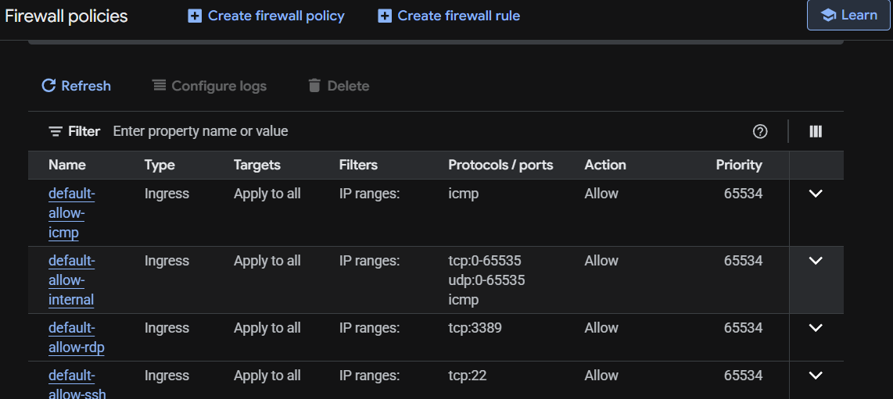

`default-allow-ssh` (TCP 22), `default-allow-rdp` (TCP 3389), `default-allow-icmp` and
`default-allow-internal` (all TCP, UDP and ICMP between machines on the network), all ingress, applying to
every VM, at priority 65534. The screenshot truncates the source-range column, so where the traffic may
come *from* was not read directly; the usual defaults for the first three are the whole internet
(`0.0.0.0/0`), which would expose SSH and RDP to anyone for any VM placed there. That alone is enough to
rule the default network out for this node.

Plan: create a custom-mode VPC with a single subnet whose range overlaps neither the lab (`10.10.10.0/24`)
nor Tailscale (`100.64.0.0/10`), add **no** ingress allow rules from the internet, and delete the default
network. GCP's implied rules deny all ingress and allow all egress, so outbound connections, which
Tailscale and the Wazuh agent both use, work without any inbound exposure.

### The replacement network

A custom-mode VPC, `lab-vpc`, was created with one subnet, `lab-subnet`, in `europe-west8` (Milan), IPv4
only, range `10.20.0.0/24`. The range overlaps neither the lab network (`10.10.10.0/24`) nor Tailscale
(`100.64.0.0/10`). The pre-made firewall rule options were left unticked, and the `default` network was
deleted, which removed its four rules.


Confirmed from Cloud Shell:

```bash
gcloud compute networks subnets list
gcloud compute firewall-rules list --format=json
```

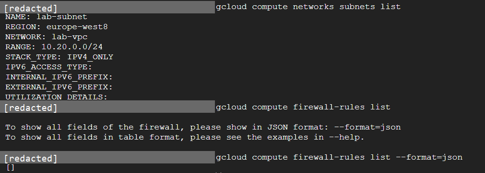

`lab-subnet` is in `europe-west8` on `lab-vpc`, range `10.20.0.0/24`, IPv4 only. The firewall rule list is
`[]`: no rules at all, so only GCP's implied rules apply (deny all ingress, allow all egress). The account
name and project ID in the shell prompt are redacted.

## GCP: the administration path

With no inbound rules the cloud VM cannot be logged into, so one narrow exception was added, run from
Cloud Shell against the lab project:

```bash
gcloud compute firewall-rules create allow-iap-ssh \
  --network=lab-vpc --direction=INGRESS --action=ALLOW --rules=tcp:22 \
  --source-ranges=35.235.240.0/20 --target-tags=iap-ssh \
  --description="SSH only through Identity-Aware Proxy"
```

It allows SSH only from Google's Identity-Aware Proxy range and only to VMs tagged `iap-ssh`; Google checks
the login before forwarding, so nothing on the internet can reach port 22. The command reported the rule
created on `lab-vpc` (ingress, TCP 22, priority 1000, enabled).


Listing the rules confirms the source range and the tag, and that it is the only rule on the network:


The account name and project ID in the shell prompts and URLs of these screenshots are redacted.

A first attempt failed to find the network: Cloud Shell was pointed at a different project from the one
holding `lab-vpc`, and offered to enable the Compute API there. Answering yes would have created a second
`default` network with open SSH and RDP rules, so the prompt was declined and the project was switched with
`gcloud config set project`. The active project is worth checking before any `gcloud` change.


## The cloud VM

Created from Cloud Shell against the lab project, with the guardrails in the command:

```bash
gcloud compute instances create gcp-node01 \
  --zone=europe-west8-a --machine-type=e2-small \
  --image-family=rocky-linux-10 --image-project=rocky-linux-cloud \
  --boot-disk-size=20GB --boot-disk-type=pd-balanced \
  --network-interface=subnet=lab-subnet \
  --tags=iap-ssh \
  --metadata=enable-oslogin=TRUE \
  --no-service-account --no-scopes
```

- **Image:** the stock `rocky-linux-10` family from Google's public `rocky-linux-cloud` project, to match the
  manager. The "optimized" and arm64 families were not used; what the optimized variants change was not
  checked.
- **Size:** `e2-small` (2 vCPUs, 2 GB). `e2-micro`'s 1 GB leaves little room once auditd and the agent run.
- **`--tags=iap-ssh`** makes the IAP firewall rule apply to this VM.
- **`--no-service-account --no-scopes`** gives the VM no Google credentials of its own, so a compromise of
  it could not be used against the project. The agent needs none.
- **`enable-oslogin=TRUE`** ties SSH to the Google identity and IAM permissions instead of key files in
  project metadata.

The VM came up `RUNNING` with internal address `10.20.0.2` in `lab-subnet`. It also received an ephemeral
public address, which it needs to reach the internet for Tailscale and package installs.

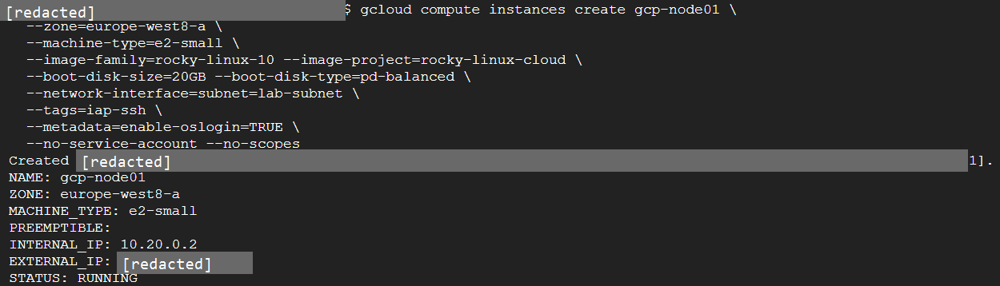

The account name, project ID and public address are redacted in the screenshot.

**Direct connection test.** Direct connection attempts to that public address on TCP 22, 3389, 443
and 1514 all failed, so nothing answers on it. A timeout cannot distinguish a filtering firewall from a
service that is not yet running, so the stronger evidence will be IAP login working while direct SSH does not. Where these attempts were
made from was not recorded, so a repeat from the home network is still to do.

**Login through IAP.** The first `gcloud compute ssh --tunnel-through-iap` generated an SSH key pair in
Cloud Shell and registered its public half in the account's OS Login profile; nothing was written into the
VM's metadata. The login then succeeded and `whoami` returned an account derived from the Google identity.
That is the check the negative test was waiting for: direct connections to the public address fail while the
IAP path works, so the single ingress rule does what it was meant to. (A tunnel-performance warning about
NumPy appeared and is irrelevant to this use.)

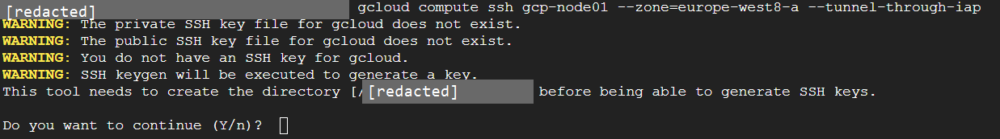


The first screenshot is the one-off prompt to create an SSH key in Cloud Shell. In the second, the passphrase
prompt, the home directory created for the OS Login account and the shell prompt all contain the account
name and are redacted.

## Joining the cloud VM to Tailscale

The same repository and package as on the manager, installed on `gcp-node01` over the IAP session:

```bash
sudo curl -fsSL https://pkgs.tailscale.com/stable/rhel/10/tailscale.repo -o /etc/yum.repos.d/tailscale.repo
sudo dnf install -y tailscale
sudo systemctl enable --now tailscaled
```


The VM then joined with an auth key created in the admin console for the tag `tag:cloud-agent`, intended as
one-time with a short expiry, so the node attaches to the role and not to a person. The key was read
without echo and kept out of the shell history, and the variable cleared straight afterwards. It is a secret
and appears nowhere in this repository:

```bash
read -rs -p "Auth key: " TSKEY; echo
sudo tailscale up --auth-key="$TSKEY" --accept-dns=false; unset TSKEY
```


`--accept-dns=false` is kept here for a different reason than on the manager: the VM relies on Google's own
resolver and nothing in this design uses Tailscale's names. `tailscale up` prints nothing on success, so the
screenshot alone proves nothing; the admin console is the evidence. It lists `gcp-node01` as connected, with
`tag:cloud-agent` and the tunnel address `100.87.137.72`, next to `wazuh-manager`.

**Key expiry.** Both machines show "Expiry disabled". The manager needed that setting changed by hand after
it was tagged, but this VM has it without any action. That fits the earlier surprise being specific to a
device tagged after it had already joined, whereas this one joined with a tagged auth key from the start.
This was first an inference from one example. Tailscale's tags documentation later confirmed it: key expiry
is disabled by default when a device is first tagged and authenticated, and changing tags afterwards does not
alter expiry unless the device re-authenticates, which is exactly what happened on the manager.

The Machines page itself is not in the repository.

## Password for agent enrolment

Wazuh's enrolment service on TCP 1515 accepts any agent that can reach it, with no password, by default.
The setup follows Wazuh's documented procedure on the manager: enable `use_password` in the `<auth>` section
of `ossec.conf`, store the password in a root-owned `authd.pass`, restart the manager.

The starting state was read first, and the file backed up before it was changed:

```bash
sudo grep -n -A8 "<auth>" /var/ossec/etc/ossec.conf        # use_password was "no"
sudo cp -p /var/ossec/etc/ossec.conf /var/ossec/etc/ossec.conf.bak
sudo sed -i 's|<use_password>no</use_password>|<use_password>yes</use_password>|' /var/ossec/etc/ossec.conf
```

The password was generated from the kernel's random source, because the Wazuh installer removed `openssl`,
and written without passing through the shell history, then given the permissions Wazuh specifies:

```bash
PW=$(head -c 24 /dev/urandom | base64 | tr -d '/+=' )
printf '%s\n' "$PW" | sudo tee /var/ossec/etc/authd.pass > /dev/null; unset PW
sudo chmod 640 /var/ossec/etc/authd.pass && sudo chown root:wazuh /var/ossec/etc/authd.pass
```


The generated password is redacted in the screenshot. The `<auth>` block shows the surrounding defaults:
port 1515, `purge` on, and `ssl_verify_host` off. The setting applies to new enrolments only, since the two
Windows agents already hold their keys.

The manager was then restarted so the setting takes effect:

```bash
sudo systemctl restart wazuh-manager
sudo systemctl is-active wazuh-manager
sudo ss -tlnp | grep 1515
```


The manager is `active` and `wazuh-authd` is listening on `0.0.0.0:1515`. That is every interface, so the
lab network can reach the enrolment port as well as the tunnel; the control is now the password, together
with the firewall zones that decide who can reach the port at all. A check that both Windows agents remain
active is still to confirm.

## Testing the tunnel from the cloud VM

Before installing anything, the manager's tunnel address was probed from `gcp-node01` with bash's built-in
TCP redirection, so no extra tools were needed. A port counts as open if the connection completes within six
seconds:

```bash
for p in 1514 1515 22 443 55000; do
  printf "port %-6s " $p
  timeout 6 bash -c "exec 3<>/dev/tcp/100.73.251.78/$p" 2>/dev/null && echo OPEN || echo "refused/filtered"
done
```


| Port | Service | Result |
|---|---|---|
| 1514 | Agent events | open |
| 1515 | Enrolment | open |
| 22 | SSH | refused or filtered |
| 443 | Dashboard | refused or filtered |
| 55000 | Wazuh API | refused or filtered |

This matches the design: the two agent ports answer and the three management ports do not. It is the first
live use of the access policy and the manager's `tailnet` zone together.

**What this does not prove.** The script cannot tell a refusal from a silent drop, and it cannot tell which
layer blocked a port. Two controls both say no to 22, 443 and 55000: the Tailscale policy and the `firewalld`
zone. A port blocked by either would look identical here. Showing that the `firewalld` layer works on its own
was done later, in "The host firewall layer on its own" below. The OS Login username in the prompt is
redacted in the screenshot.

## Installing and enrolling the Wazuh agent

The repository definition and key were added from the documented RPM procedure, which I did not check against
Wazuh's installation page first; it worked, and the package came from the repository:

```bash
sudo rpm --import https://packages.wazuh.com/key/GPG-KEY-WAZUH
sudo tee /etc/yum.repos.d/wazuh.repo > /dev/null <<'EOF'
[wazuh]
gpgcheck=1
gpgkey=https://packages.wazuh.com/key/GPG-KEY-WAZUH
enabled=1
name=EL-$releasever - Wazuh
baseurl=https://packages.wazuh.com/4.x/yum/
protect=1
EOF
```

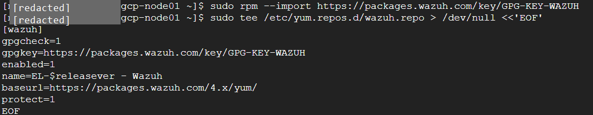

The agent was pinned to the manager's version (an agent must not be newer than its manager), with the
manager's tunnel address and the chosen agent name passed as deployment variables. The installer does not
start the service:

```bash
sudo WAZUH_MANAGER='100.73.251.78' WAZUH_AGENT_NAME='gcp-node01' dnf install -y wazuh-agent-4.14.9
```

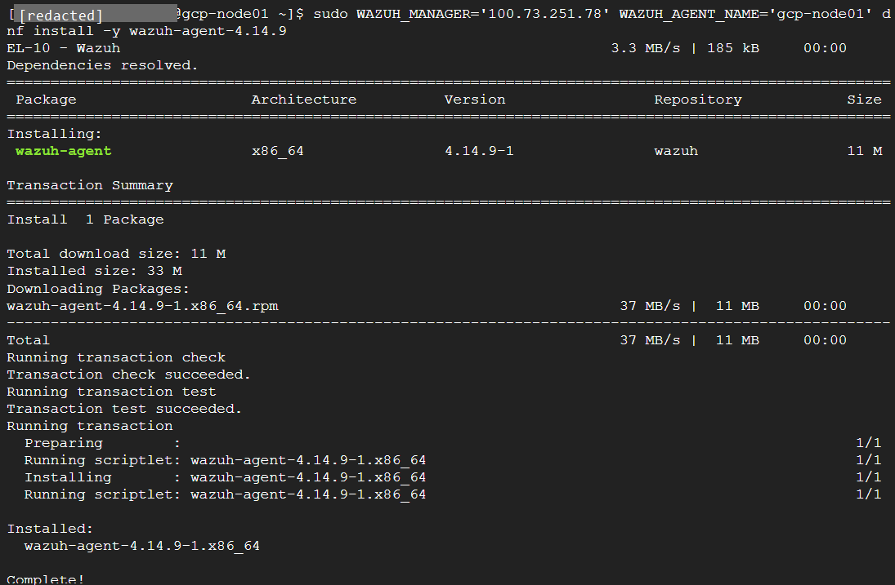

`wazuh-agent-4.14.9-1` installed from the `wazuh` repository. The first listing of available versions
(`dnf list --showduplicates`) was skipped; the pinned install succeeding shows the version exists. One worry
did not materialise: `sudo` normally resets the environment, but the variables arrived, and the config
contains the manager address.

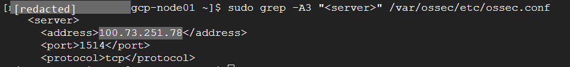

The enrolment password was written to `authd.pass` the same way as on the manager, read without echo so it
never reaches the shell history or the process list, with the permissions Wazuh specifies:

```bash
read -rs -p "Enrolment password: " PW; echo
printf '%s\n' "$PW" | sudo tee /var/ossec/etc/authd.pass > /dev/null; unset PW
sudo chmod 640 /var/ossec/etc/authd.pass && sudo chown root:wazuh /var/ossec/etc/authd.pass
```

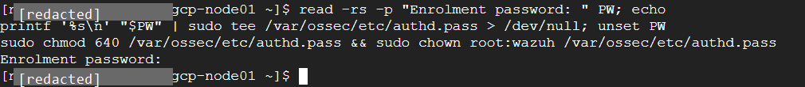

The agent was then started:

```bash
sudo systemctl enable --now wazuh-agent
```

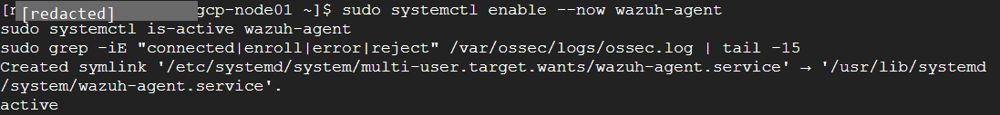

**How enrolment was verified.** The service reported `active`, but the log search printed nothing in the
same second, and the log itself was never read afterwards, so there is no log excerpt here. The evidence is
on the manager instead: `agent_control -l` lists `gcp-node01` as ID 003, `Active`, and the dashboard agent
page shows it active at version 4.14.9 with the tunnel address `100.87.137.72`, registered on 4 November and
with a recent keep-alive on 5 November. Its inventory is populated (2 cores, 1.7 GB, hostname `gcp-node01`),
and the events graph begins with a burst right after enrolment. That shows events arriving, though no
marker event was sent. The dashboard screenshots are not kept in the repository.

The enrolment password worked on first use, which also shows the manager was restarted after the rotation.

**Windows agents.** `agent_control -l` listed `DC01` and `WIN10-CLIENT` as `Disconnected`. Both VMs had been
shut down to save RAM, so this is expected. Both were seen active right after the enrolment-password restart
(not captured); they have not been seen since the VMs were powered on again.

## Host firewall on the cloud VM

I had assumed this VM needed nothing beyond the Tailscale policy and the VPC firewall, and then noticed I had
not looked at the VM's own host firewall. Reading it first:

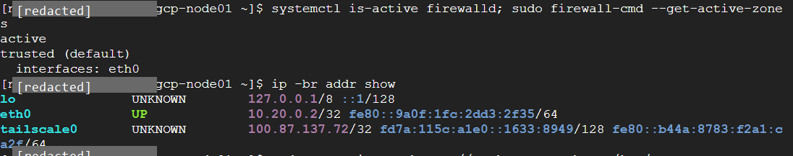

`firewalld` is active, but `eth0` is in the **`trusted`** zone, which is also the default. `trusted` accepts
all traffic. `tailscale0` is not listed in any zone, so its traffic falls to the default zone too. I did not
set this and do not know whether it is how the image ships. The VM has an **ephemeral external IP**
(confirmed in the console; not captured), so the internet can reach it in principle, and the
only thing in the way was the VPC firewall: one ingress rule, IAP on TCP 22, with everything else denied by
default. Nothing was exposed, because nothing important listens, but there was no host layer behind the
VPC, so a mistaken VPC rule would have exposed every port. The misconfiguration demo planned for the end of
this phase does exactly that on purpose.

Before switching, the `public` zone's contents were read, so SSH over IAP would not be cut off:
`services: cockpit dhcpv6-client ssh`. The SSH service is there. The host firewall allows SSH from any source;
the restriction to Google's IAP range is the VPC rule's job, not the host's.

```bash
sudo firewall-cmd --set-default-zone=public
sudo firewall-cmd --get-active-zones
```

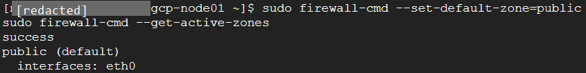

`eth0` now sits in `public`. Rollback from a still-open session is `--set-default-zone=trusted`; the change
is permanent, so a reboot would not undo it.

**Checked afterwards.** A new IAP SSH session logged in successfully after the change (confirmed by me, not captured), so SSH still passes the zone. The agent stayed active in the dashboard, but I cannot
show that its last keep-alive came after the change. `cockpit` (web console, 9090) remains allowed in the
zone; it is unused and could be removed.

## ICMP through the tunnel

I predicted plain `ping` to the manager's tunnel address would time out: the policy rule is `proto: tcp`, and
I believed the `tailnet` zone would not pass ICMP. **That prediction was wrong.** Fourteen of fourteen
replies came back, with round trips of 77 to 329 ms.

The zone listing showed why `firewalld` passed it: `icmp-blocks` was empty, and `firewalld` allows ICMP
unless told otherwise. Blocking echo requests in the zone, runtime only, changed the result:

```bash
sudo firewall-cmd --zone=tailnet --add-icmp-block=echo-request
```

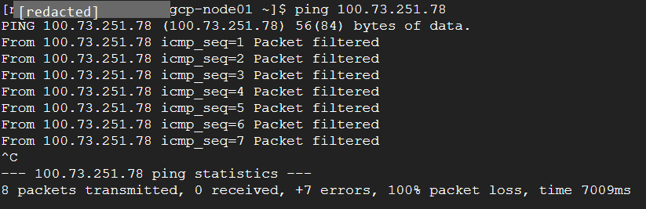

Every ping now returns "Packet filtered" **from `100.73.251.78`**: the manager's firewall rejected it and said
so, instead of silently dropping it. Two conclusions:

- The host layer is live and can deny traffic on its own. This is for ICMP only. It does not prove the TCP
  port restrictions work without the Tailscale policy; that test follows in "The host firewall layer on
  its own".
- Tailscale filters packets before the kernel sees them, so for `firewalld` to have rejected the ping, the
  policy layer had already let ICMP echo through despite the rule saying TCP only. **At the time this was
  unexplained.** I compared the policy saved in the console with
  [../cloud/tailscale-policy.json](../cloud/tailscale-policy.json) and found them identical (not captured),
  which ruled out a leftover rule. **Later resolved from Tailscale's documentation** (policy syntax page): when
  traffic is allowed between a pair of addresses, ICMP is allowed between them too. So ICMP between two nodes
  is permitted whenever any traffic between them is, whatever `proto` says, and the policy layer is not
  where ICMP is stopped. That makes the `firewalld` block the right place for it.

The block was then made permanent (`--permanent --zone=tailnet --add-icmp-block=echo-request` and a reload),
so the zone does what the notes claim: only TCP 1514 and 1515. `tailscale ping`, which is a Tailscale-level
probe and not ICMP through the tunnel, is unaffected.

The earlier port test also cannot tell a rejection from a drop, since both print "refused/filtered" after a
timeout. A reject returns immediately; a drop times out. Showing the difference would need a probe that
reports how it failed.

## Relayed path

`tailscale ping` from the VM to the manager reported every reply `via DERP(fra)`, Tailscale's relay in
Frankfurt, with round trips between 83 and 352 ms:

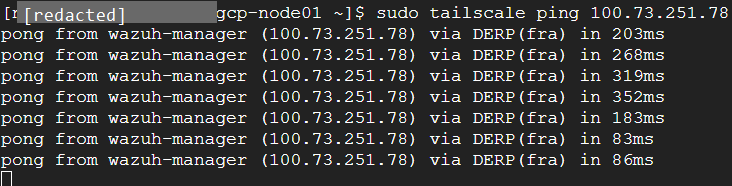

So the tunnel is relayed, not direct. Relayed traffic is still end to end encrypted, and the latency is
fine for security events. The likely cause is that the manager sits behind two NATs (VMware's and the home
router), which often defeats direct connections. **That is a guess.** The VM's host-firewall change could
also be a factor, and there is no measurement from before it. Two tests would settle it and were
deliberately set aside: pinging with the zone temporarily back in `trusted`, and `tailscale netcheck` on the
manager to see its NAT behaviour.

## The host firewall layer on its own

Two controls guard the manager's tunnel interface: the Tailscale policy and the `tailnet` zone. Every earlier
test was blocked by both at once, so none showed that the zone holds if the policy is wrong. The probe was
first improved so it reports *how* a port fails, not just that it does. A silent drop times out; a
rejection returns immediately with an error. Run on `gcp-node01` against the manager's tunnel address:

```bash
for p in 1514 1515 22 443 55000 9200; do
  printf "port %-6s " $p
  timeout 6 bash -c "exec 3<>/dev/tcp/100.73.251.78/$p" 2>&1 | head -1
  [ ${PIPESTATUS[0]} -eq 0 ] && echo OPEN
done
```

**Baseline, normal policy.** 1514 and 1515 open; 22, 443, 55000 and 9200 print `Terminated`. That word is
bash reporting that `timeout` killed the attempt after six seconds, not a network error: the packets got no
answer at all. 9200 (the Wazuh indexer) was added to the list and is blocked the same way.

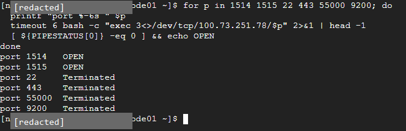

**Policy widened.** In the Tailscale console the access rule was temporarily changed to allow
`tag:cloud-agent` to reach `tag:manager:*` (every TCP port), and the `deny` assertions were removed from the
policy tests, because the console refuses to save a policy that fails its own tests. Nothing else changed,
and the versioned file in the repo stayed untouched as the restore point. After allowing time for the policy
to propagate, the same probe gave:

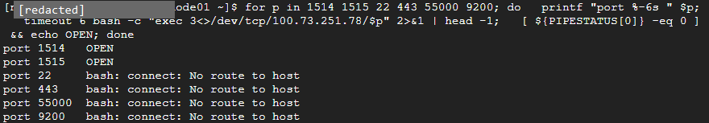

1514 and 1515 were still open, and 22, 443, 55000 and 9200 now failed **immediately** with `No route to
host`, which is the error a client gets when the far end's firewall sends back an ICMP "host prohibited".
So with the policy no longer in the way, the manager's `firewalld` rejected every port outside the zone's two.

| State | Ports 22, 443, 55000, 9200 | Stopped by |
|---|---|---|
| Normal policy | Silent timeout | The Tailscale policy drops them first |
| Policy widened | Immediate `No route to host` | `firewalld` rejects them |

The mapping from "timeout" to the policy and "immediate error" to `firewalld` is an interpretation. The
second half is directly shown by the widened run; the first half follows because only the policy was
changed between the two runs.

The policy was then restored from the versioned file, and it saved (its tests pass). A final probe matched the baseline but was not captured.

**Limits.** This covers TCP on four ports with the rule widened to all TCP ports. Other ports and UDP were
not probed. It does not test the reverse (the policy holding with the host firewall open), which I chose
not to do, since weakening the host firewall on purpose is not worth the risk. During the window the cloud
node could in principle have tried any port on the manager, with the zone as the only barrier; that is what
was being tested, and the cloud node is the only machine with that tag.

## Cloud Audit Logs: the cloud side

The goal is to see changes to the cloud account itself, such as a firewall rule being created, which the
agent on the VM cannot see because those are API calls to Google. Admin Activity audit logs record them, are
on by default and cannot be switched off. Wazuh's GCP module reads them from a Pub/Sub subscription. The
current documentation was read first, which corrected two assumptions: the Wazuh manager already ships the
module's Python dependencies, so nothing is installed with `pip`; and Wazuh's credentials page grants the
service account both Pub/Sub Publisher and Subscriber, which is more than a reader needs (see below).

All commands ran in Cloud Shell with the project named explicitly through a variable, `P`, holding the
project ID, because that shell has pointed at the wrong project before:

```bash
gcloud services enable pubsub.googleapis.com --project=$P
gcloud pubsub topics create lab-audit-logs --project=$P
gcloud pubsub subscriptions create wazuh-pull --topic=lab-audit-logs --project=$P
```

The sink copies Admin Activity entries, and only those, into the topic. Google gives a sink its own writer
identity, which has to be allowed to publish before anything is delivered. The permission is on the topic,
not the project, which is narrower than the example in Google's page:

```bash
gcloud logging sinks create lab-audit-sink pubsub.googleapis.com/projects/$P/topics/lab-audit-logs \
  --log-filter='log_id("cloudaudit.googleapis.com/activity")' --project=$P
W=$(gcloud logging sinks describe lab-audit-sink --project=$P --format='value(writerIdentity)')
gcloud pubsub topics add-iam-policy-binding lab-audit-logs --member="$W" --role=roles/pubsub.publisher --project=$P
```

Google's page also mentions a Logs Writer role for destinations. It was not granted, on the belief that
Pub/Sub does not need it here; if entries do not arrive, that is the first thing to add.

The reader for Wazuh is a service account that starts with no permissions and gets Subscriber on the one
subscription only:

```bash
gcloud iam service-accounts create wazuh-pubsub-reader --display-name="Wazuh Pub/Sub reader" --project=$P
SA="wazuh-pubsub-reader@$P.iam.gserviceaccount.com"
gcloud pubsub subscriptions add-iam-policy-binding wazuh-pull --member="serviceAccount:$SA" \
  --role=roles/pubsub.subscriber --project=$P
gcloud projects get-iam-policy $P --flatten=bindings --filter="bindings.members:wazuh-pubsub-reader" \
  --format="value(bindings.role)"
```

The last command printed nothing, so the account holds no project-wide role. This is narrower than Wazuh's
own instructions (Publisher plus Subscriber, with no stated scope). Whether the module works with only
Subscriber on one subscription is **not yet tested**; if it fails with a permission error, the missing
permission gets added and recorded here.

The Cloud Shell screenshots for these steps are not in the repository: each carries the account name, the
project ID and the project number several times over, and they show nothing the commands above do not.

## Cloud Audit Logs: the key, the module and the first events

**The platform refused to issue a key.** Creating the JSON key in the console failed with "Service account key
creation is disabled": the organization enforces the constraint `iam.disableServiceAccountKeyCreation`. The
page says it may come from Google's "Secure by Default" settings; whether it did here was not checked. This
is the same principle as the project's own "no key files" guardrail, so it was treated as a signal and not a
bug. Two ways round it were weighed (the decision is in `decisions.md`): override the constraint on this one
project for a few minutes, or avoid a key entirely by pulling the logs from the VM with an attached service
account. The override was chosen. I turned enforcement off for the project, downloaded the key, and then restored the policy
immediately afterwards. None of that was captured.

**The key.** It was copied from the laptop to the manager over `scp`, installed with the owner and mode in
one step, and the temporary copy shredded:

```bash
sudo install -m 640 -o root -g wazuh /tmp/gcp-key.json /var/ossec/wodles/gcloud/gcp-credentials.json
sudo shred -u /tmp/gcp-key.json
```

The listing afterwards showed `gcp-credentials.json` as `-rw-r-----`, `root:wazuh`, next to Wazuh's own
module files. The Downloads folder is not synced to OneDrive and the laptop copy was deleted (not captured). Deleting a file does not securely erase it from an SSD, so the real cleanup
is revoking the key in the console at the end of the trial. The commands ran in a root shell, which was not
the intent.

**The module.** The config was backed up, then a separate `<ossec_config>` section was appended with the
module enabled, a one-minute interval, pulling on start, the project, the `wazuh-pull` subscription and the
credentials path. `wazuh-analysisd -t` printed nothing, and after a restart the log showed only
`gcp-pubsub: INFO: Module started.`

**How it was verified.** That log line proves the module runs, not that it reads. Its routine activity does
not appear to be logged at the default level (my belief, not tested), so the checks used the data instead:

- six alerts carrying the GCP integration were in `alerts.json`;
- peeking at the subscription, without acknowledging, returned zero messages, so Wazuh had taken and
  acknowledged what was waiting.

So **Subscriber on the one subscription is enough** for the module to pull. Wazuh's guide also grants
Publisher, which turned out not to be needed for reading.

**What arrived.**

| Rule | Level | Description | Seen |
|---|---|---|---|
| 65042 | 3 | GCP notice event, resource type `audited_resource` | 2 |
| 65043 | 7 | GCP error event, resource type `service_account` | 3 |
| 65071 | 3 | GCP new key is created for a service account (MITRE T1098.001, Persistence: Additional Cloud Credentials) | 1 |

The 65071 alert is the key created for this module: the SIEM flagged the lab's own credential creation. The
three level-7 error events on a service account are most likely the blocked key-creation attempts, but the
API method names were not inspected, so that is an inference. It is also not established which of the
other actions (creating the service account, the permission bindings) produced the two notice events or
produced no alert at all; events that match no rule do not appear. The alert screenshots are not kept in
the repository because they show the project ID.

**Left to do here.** Cleanup of the key and the subscription at the end of the trial.

## Misconfiguration demo: an open firewall rule, detected and fixed

The demo shows a dangerous cloud change being noticed by the SIEM, with before-and-after evidence. The
mistake is the most common cloud one: a firewall rule that allows a management port from the whole internet.
It is a **simulation**: the rules were created *disabled* and aimed at a network tag no VM carries
(`demo-no-such-tag`), so nothing was ever exposed. The audit log records the creation either way, and the
detection is on the change, not on any traffic. I confirmed the first rule's state with `describe`:
disabled, source `0.0.0.0/0`, target tag `demo-no-such-tag`.

**The terms.** Google's penetration-testing page says no prior notice or approval is needed and that tests
must stay within your own projects and not affect other customers. It defers to the Acceptable Use Policy
for what is prohibited, and **I have not read that policy in full**. The demo only changes a setting in the lab's own project, with no
scanning or traffic against anything; I do not expect a conflict, but that is an expectation, not a check.

**Before.** `gcloud compute firewall-rules list --filter="network:lab-vpc"` showed one rule, `allow-iap-ssh`,
enabled. (An earlier attempt used `--network` on `list`, which that command does not accept; the filter form
is the right one.)

**The first mistake.** A rule `demo-open-ssh` (TCP 22 from `0.0.0.0/0`, disabled) was created. Two alerts
reached Wazuh, both from the built-in rule 65053, "GCP firewall rule created" (level 3, MITRE T1562). So
Wazuh already saw the event, but nothing said it was dangerous. The event's fields included the method name
(`v1.compute.firewalls.insert`), `request.sourceRanges`, `request.alloweds`, `request.disabled`,
`request.targetTags` and `request.direction`, which is what a rule can be built on. The field names were read
from the real alert, not guessed.

**The rule.** Custom rule 100500 ([../cloud/wazuh/100500-gcp-firewall-open-to-internet.xml](../cloud/wazuh/100500-gcp-firewall-open-to-internet.xml),
card in [../detections/cards/gcp-firewall-rule-open-to-internet.md](../detections/cards/gcp-firewall-rule-open-to-internet.md))
was appended to `local_rules.xml` after a backup and a check that the ID was unused. `wazuh-analysisd -t`
printed nothing, and the manager was restarted. It fires when a firewall rule is inserted, patched or
updated with `0.0.0.0/0` among its source ranges, at level 12, mapped to T1562.007.

**The second mistake.** A rule `demo-open-rdp` (TCP 3389, same source, disabled) was created, deliberately on
a different port to show the rule is not tied to SSH. One alert came back from rule 100500:

```
"rule":{"level":12,"description":"GCP firewall rule created or changed to allow 0.0.0.0/0 (open to the internet)","id":"100500","mitre":{"id":["T1562.007"],"tactic":["Defense Evasion"],"technique":["Disable or Modify Cloud Firewall"]}
```

Searching that alert for rule names found `demo-open-rdp` and not `demo-open-ssh`, as it should be, since the
SSH rule was created before the custom rule was loaded. The count of ten printed by that search is the
number of times the name appears in the matched text, not ten alerts.

**The fix.** Both demo rules were deleted and the list showed only `allow-iap-ssh` again. The deletions
were logged too: four alerts from the built-in rule 65054, "GCP firewall rule deleted" (level 3, T1562.007),
two per rule. Together with the two alerts per creation, that shows Compute writes two audit entries per
operation. The custom rule fired once per creation, so only one of the two entries carries the request
fields; that is an inference from the counts.

**Limits.** The rule was tested through the live pipeline, not with `wazuh-logtest`. It fires even for a
disabled rule (as here), does not look at whether the rule allows or denies, ignores the port, and misses
IPv6 and wide ranges that are not exactly `0.0.0.0/0`. Those false positives and gaps are listed in the card
as tuning work. The Cloud Shell screenshots for this demo are not in the repository, for the reasons above;
the outputs are quoted as text.

