# Phase 3 — Cloud node build notes

Extends the lab with a cloud VM that reports to the on-premises Wazuh manager. The provider is **Google
Cloud (GCP)** on its Free Trial and the link is a **Tailscale** mesh VPN; both choices and the rejected
alternatives are in [decisions.md](decisions.md), and the connectivity design is in
[network-plan.md](network-plan.md). AWS was the original choice and was dropped when the account turned out
not to be eligible for its free plan; the decisions log has the full account.

## Tailscale on the manager

Tailscale is installed on the Rocky manager itself, so the tunnel terminates where the service runs,
rather than on the laptop. The repository definition was read before use: HTTPS, with both package and
repository signature checking enabled, and the signing key served from the same host.

```bash
sudo curl -fsSL https://pkgs.tailscale.com/stable/rhel/10/tailscale.repo -o /etc/yum.repos.d/tailscale.repo
sudo dnf install -y tailscale
sudo systemctl enable --now tailscaled
sudo tailscale up --accept-dns=false
```

The repo file was fetched directly rather than through `dnf config-manager`, which depends on a plugin that
a minimal install may not have.


The signing key was imported and the transaction checks passed. Tailscale 1.104.4 installed, along with
`iptables-nft` as a dependency. The login URL printed by `tailscale up` is a one-time link tying the machine
to an account, so it is redacted in the screenshot.

**`--accept-dns=false`.** On Linux, Tailscale by default takes over DNS configuration. That would risk
overwriting the resolver arrangement verified in Phase 1 (the domain controller first, the NAT gateway as
fallback), and this host does not need Tailscale's name resolution.

The manager received the tunnel address `100.73.251.78`. Tailscale's `100.64.0.0/10` range overlaps none of
the lab network or the AWS and Azure default ranges. GCP's default network ranges have not yet been checked
against the lab and the tunnel range; that check belongs with creating the project's network.


The admin console shows the manager connected. Account email, device ID, node key, tailnet domain and
external endpoints are redacted. The page reports key expiry **six months from now**: untagged devices carry
the default expiry, so without action the manager would silently drop off the network after that period.
Tagging it was expected to remove that; see the result under *Access policy* below, which did not bear
that expectation out.

## Access policy

Tailscale's default policy lets every device reach every other on every port. The cloud VM is the
internet-facing, less-trusted machine and the manager is the one that matters most, so the default is
replaced with a single permission. The file is versioned as [../cloud/tailscale-policy.json](../cloud/tailscale-policy.json);
it holds tags and ports only, nothing secret.


- **Tags** (`tag:manager`, `tag:cloud-agent`) label machines by role rather than by owner, so the rule
  survives rebuilding the cloud VM: a replacement with the same tag is covered without editing the policy.
  Tagged machines also authenticate with a pre-made key rather than a person's login, which suits servers.
- **One rule.** Machines tagged `cloud-agent` may open TCP connections to machines tagged `manager` on
  1514 (agent events) and 1515 (enrolment), and nothing else. Policy is default-deny, so SSH, the dashboard
  and the API are unreachable from the tunnel. Rules are stateful, so replies need no reverse rule.
- **Tests.** The policy carries assertions that the two Wazuh ports are allowed and that 22, 443 and 55000
  are denied. The console evaluates them on save and refuses a policy that contradicts them, and they
  re-run on every later edit, which guards against a typo opening something by accident.

This cannot lock out administration: the policy is managed through the account in the browser, and the
manager is reached over SSH on the lab network rather than the tunnel.

The manager was then tagged:

```bash
sudo tailscale up --accept-dns=false --advertise-tags=tag:manager
```

`tailscale up` requires every non-default flag to be restated, which is why `--accept-dns=false` appears
again. The command returned without error.

The console confirms it:

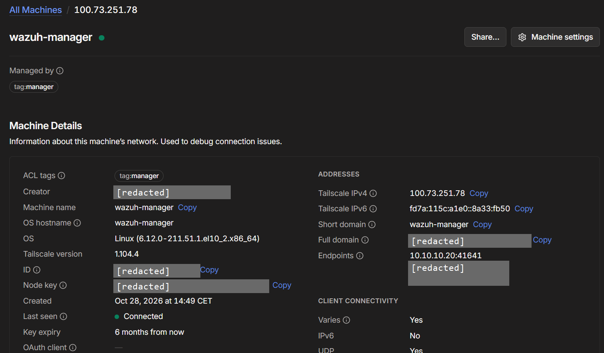

The machine now carries `tag:manager`, and "Managed by" has changed from a user account to the tag. A tag
can only be applied if the policy defines it, so the policy saved; and the console only saves a policy
whose tests pass, so the tests passed.

**Key expiry did not change.** The page still reports expiry six months from now. The assumption that
tagging disables expiry was wrong for this device, which was tagged after it had already joined; whether
that holds for devices that join with a tag already attached has not been checked. The manager therefore
still needs expiry disabled explicitly, or it will drop off the network when the key lapses.

## Host firewall on the tunnel interface

The tunnel interface was placed in its own `firewalld` zone, so tunnel traffic is limited to the two Wazuh
ports by the host as well as by the Tailscale policy. The expectation was that, without a zone of its own,
`tailscale0` would fall into the default `public` zone and inherit everything open there, including the
dashboard and the API. **That was not checked beforehand**: the zone state was not captured before the
change, and the only earlier baseline predates the Tailscale install, so it could not show the interface at
all. The commands were additive and reversible and did not touch the lab interface, so the risk was low,
but the starting state should have been recorded first (`firewall-cmd --get-active-zones` and
`--list-all-zones`):

```bash
sudo firewall-cmd --permanent --new-zone=tailnet
sudo firewall-cmd --permanent --zone=tailnet --add-port=1514/tcp
sudo firewall-cmd --permanent --zone=tailnet --add-port=1515/tcp
sudo firewall-cmd --permanent --zone=tailnet --add-interface=tailscale0
sudo firewall-cmd --reload
sudo firewall-cmd --get-active-zones
```


`ens160` stays in `public` and `tailscale0` is in `tailnet`. The lab is unaffected: the Windows agents
arrive on `ens160`, and Tailscale's own encrypted packets also arrive there rather than on `tailscale0`.

### Does Tailscale's own firewall bypass the zone?

On Linux, Tailscale installs its own rules. Inspecting them showed the concern was real in part: the
`ts-input` chain, which the `INPUT` hook jumps to, contains

```
iifname "tailscale0" counter accept
ip saddr 100.64.0.0/10 iifname != "tailscale0" counter drop
```

The first accepts anything arriving on the tunnel interface. The second drops packets claiming a tailnet
source address on any other interface, an anti-spoofing rule that would be lost if Tailscale's firewall
handling were switched off (`--netfilter-mode=off`), which is a reason not to.

The first reading was that the accept rule would let tunnel traffic skip `firewalld`. That was too strong.
Tailscale's rules live in the `ip filter` table managed by `iptables-nft`, while `firewalld` keeps its
rules in a separate nftables table. In nftables an accept in one table does not stop other tables'
chains on the same hook from evaluating the packet; each registered base chain runs in priority order and
a drop or reject from any of them is final. What matters is the ordering, and it was checked:

```bash
sudo nft list table inet firewalld | grep -n -E "hook input"
# type filter hook input priority filter + 10; policy accept;
```

`firewalld`'s input chain runs at `priority filter + 10`, after Tailscale's chain at `filter`, so tunnel
traffic still passes through the `tailnet` zone's two-port limit.

That is established from the rule ordering and nftables semantics, not yet from a live test. The layers are:

1. **Tailscale policy**, enforced inside `tailscaled`: only the cloud agent, only TCP 1514 and 1515.
2. **`firewalld` `tailnet` zone**: only TCP 1514 and 1515 on the tunnel interface.
3. **Tailscale's anti-spoof rule**, dropping tailnet-sourced packets from other interfaces.

## Background: firewalld zones and the `tailscale0` interface

**Zones.** A `firewalld` zone is a named rule set describing how far to trust a network connection:
which services and ports are open, and what happens to everything else. Each interface (or source
address) is assigned to one zone, and incoming traffic is judged by the rules of the zone it arrived
through. A packet is matched to a zone by source address first, then by incoming interface, then falls
back to the default zone (`public`). Zone rules govern **incoming** connections only; connections the host
starts are allowed, and their replies are let back in by connection tracking. Configuration exists twice,
live and saved: `--permanent` writes the saved copy and `--reload` makes it live.

**The tunnel interface.** `tailscale0` is not a network card. It is a TUN interface, a software-only
interface created by `tailscaled`, with no hardware or virtual card behind it. A packet addressed to a
`100.x.y.z` peer is routed into it, `tailscaled` reads it, encrypts it with WireGuard and wraps it in an
ordinary UDP packet, and that packet leaves through the real interface, `ens160`, across the NAT and the
internet to the peer, where the process reverses.

```
 program ──▶ tailscale0 ──▶ tailscaled (encrypt) ──▶ ens160 ──▶ NAT ──▶ internet ──▶ peer
 100.x.y.z    software        WireGuard in UDP       real path
```

The manager therefore has two interfaces with two addresses and two zones: `ens160` (`10.10.10.20`, zone
`public`) carries the lab and the tunnel's encrypted packets, and `tailscale0` (`100.73.251.78`, zone
`tailnet`) carries the decrypted Wazuh traffic from the cloud VM. That is why the two zones govern
different things even though everything ultimately travels over one network card.

## GCP: cost guardrail

The cloud provider is Google Cloud on its Free Trial: a $300 welcome credit (shown as €269) valid for 90
days, expiring 1 February 2027. Google states there are no automatic charges, so spending can only begin
if the billing account is upgraded by hand; the Upgrade button is never used. A budget is still set as a
backstop and a way to watch consumption.

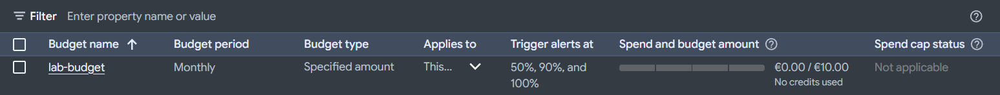

`lab-budget`: monthly, €10, alerts at 50%, 90% and 100% of actual spend, emailed to the billing
administrators. "Spend cap status: not applicable" confirms it is an alert and stops nothing.

**The default would have made it useless.** Google's documentation says that when a budget is created, all
*Savings* types are selected by default, and that actual spend is then calculated as total cost **minus**
discounts and credits. A promotional credit is one of those. During the trial the credit covers everything,
so the calculated spend stays at zero and the budget never fires. To monitor spend before credits, none of
the Savings options may be selected, and they were all cleared. The row's "No credits used" is consistent
with that, but the scope screen is the authoritative place to check it.

Limits to remember: billing data lags by hours, so an alert can arrive after the spend, and the budget
cannot prevent anything. The trial's own behaviour is the real protection.

## GCP: the default network

A dedicated project, `mini-soc-lab`, holds everything built for the cloud node, so deleting it removes the
lot. Enabling the Compute Engine API created a `default` network with four pre-made firewall rules:


`default-allow-ssh` (TCP 22), `default-allow-rdp` (TCP 3389), `default-allow-icmp` and
`default-allow-internal` (all TCP, UDP and ICMP between machines on the network), all ingress, applying to
every VM, at priority 65534. The screenshot truncates the source-range column, so where the traffic may
come *from* was not read directly; the usual defaults for the first three are the whole internet
(`0.0.0.0/0`), which would expose SSH and RDP to anyone for any VM placed there. That alone is enough to
rule the default network out for this node.

Plan: create a custom-mode VPC with a single subnet whose range overlaps neither the lab (`10.10.10.0/24`)
nor Tailscale (`100.64.0.0/10`), add **no** ingress allow rules from the internet, and delete the default
network. GCP's implied rules deny all ingress and allow all egress, so outbound connections, which
Tailscale and the Wazuh agent both use, work without any inbound exposure.

### The replacement network

A custom-mode VPC, `lab-vpc`, was created with one subnet, `lab-subnet`, in `europe-west8` (Milan), IPv4
only, range `10.20.0.0/24`. The range overlaps neither the lab network (`10.10.10.0/24`) nor Tailscale
(`100.64.0.0/10`). The pre-made firewall rule options were left unticked, and the `default` network was
deleted, which removed its four rules.

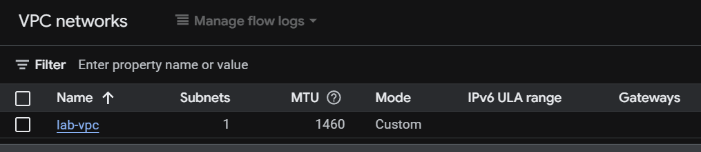

Confirmed from Cloud Shell:

```bash
gcloud compute networks subnets list
gcloud compute firewall-rules list --format=json
```


`lab-subnet` is in `europe-west8` on `lab-vpc`, range `10.20.0.0/24`, IPv4 only. The firewall rule list is
`[]`: no rules at all, so only GCP's implied rules apply (deny all ingress, allow all egress). The account
name and project ID in the shell prompt are redacted.

## GCP: the administration path

With no inbound rules the cloud VM cannot be logged into, so one narrow exception was added, run from
Cloud Shell against the lab project:

```bash
gcloud compute firewall-rules create allow-iap-ssh \
  --network=lab-vpc --direction=INGRESS --action=ALLOW --rules=tcp:22 \
  --source-ranges=35.235.240.0/20 --target-tags=iap-ssh \
  --description="SSH only through Identity-Aware Proxy"
```

It allows SSH only from Google's Identity-Aware Proxy range and only to VMs tagged `iap-ssh`; Google checks
the login before forwarding, so nothing on the internet can reach port 22. The command reported the rule
created on `lab-vpc` (ingress, TCP 22, priority 1000, enabled).

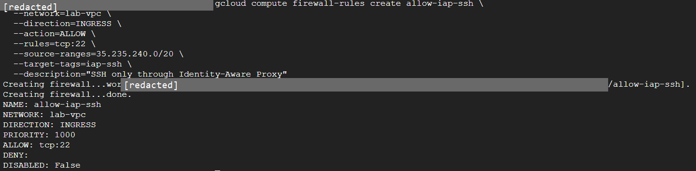

Listing the rules confirms the source range and the tag, and that it is the only rule on the network:

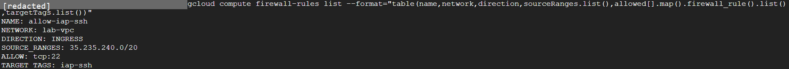

The account name and project ID in the shell prompts and URLs of these screenshots are redacted.

A first attempt failed to find the network: Cloud Shell was pointed at a different project from the one
holding `lab-vpc`, and offered to enable the Compute API there. Answering yes would have created a second
`default` network with open SSH and RDP rules, so the prompt was declined and the project was switched with
`gcloud config set project`. The active project is worth checking before any `gcloud` change.

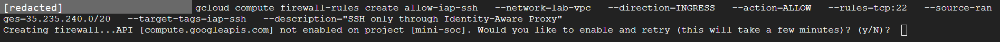

## The cloud VM

Created from Cloud Shell against the lab project, with the guardrails in the command:

```bash
gcloud compute instances create gcp-node01 \
  --zone=europe-west8-a --machine-type=e2-small \
  --image-family=rocky-linux-10 --image-project=rocky-linux-cloud \
  --boot-disk-size=20GB --boot-disk-type=pd-balanced \
  --network-interface=subnet=lab-subnet \
  --tags=iap-ssh \
  --metadata=enable-oslogin=TRUE \
  --no-service-account --no-scopes
```

- **Image:** the stock `rocky-linux-10` family from Google's public `rocky-linux-cloud` project, to match the
  manager. The "optimized" and arm64 families were not used; what the optimized variants change was not
  checked.
- **Size:** `e2-small` (2 vCPUs, 2 GB). `e2-micro`'s 1 GB leaves little room once auditd and the agent run.
- **`--tags=iap-ssh`** makes the IAP firewall rule apply to this VM.
- **`--no-service-account --no-scopes`** gives the VM no Google credentials of its own, so a compromise of
  it could not be used against the project. The agent needs none.
- **`enable-oslogin=TRUE`** ties SSH to the Google identity and IAM permissions instead of key files in
  project metadata.

The VM came up `RUNNING` with internal address `10.20.0.2` in `lab-subnet`. It also received an ephemeral
public address, which it needs to reach the internet for Tailscale and package installs.


The account name, project ID and public address are redacted in the screenshot.

**Negative test from the internet.** Direct connection attempts to that public address on TCP 22, 3389, 443
and 1514 all failed, so nothing answers on it. A timeout cannot distinguish a filtering firewall from a
service that is not yet running, so the stronger evidence will be IAP login working while direct SSH does not.

**Login through IAP.** The first `gcloud compute ssh --tunnel-through-iap` generated an SSH key pair in
Cloud Shell and registered its public half in the account's OS Login profile; nothing was written into the
VM's metadata. The login then succeeded and `whoami` returned an account derived from the Google identity.
That is the check the negative test was waiting for: direct connections to the public address fail while the
IAP path works, so the single ingress rule does what it was meant to. (A tunnel-performance warning about
NumPy appeared and is irrelevant to this use.)


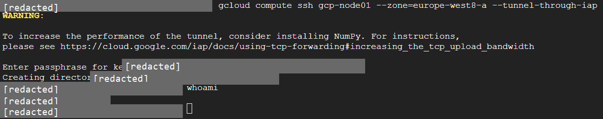

The first screenshot is the one-off prompt to create an SSH key in Cloud Shell. In the second, the passphrase
prompt, the home directory created for the OS Login account and the shell prompt all contain the account
name and are redacted.

## Joining the cloud VM to Tailscale

The same repository and package as on the manager, installed on `gcp-node01` over the IAP session:

```bash
sudo curl -fsSL https://pkgs.tailscale.com/stable/rhel/10/tailscale.repo -o /etc/yum.repos.d/tailscale.repo
sudo dnf install -y tailscale
sudo systemctl enable --now tailscaled
```

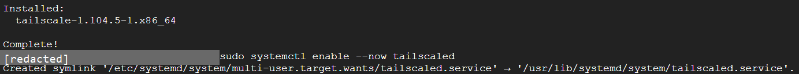

The VM then joined with an auth key created in the admin console for the tag `tag:cloud-agent`, intended as
one-time with a short expiry, so the node attaches to the role and not to a person. The key was read
without echo and kept out of the shell history, and the variable cleared straight afterwards. It is a secret
and appears nowhere in this repository:

```bash
read -rs -p "Auth key: " TSKEY; echo
sudo tailscale up --auth-key="$TSKEY" --accept-dns=false; unset TSKEY
```

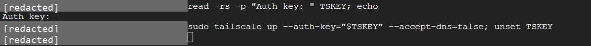

`--accept-dns=false` is kept here for a different reason than on the manager: the VM relies on Google's own
resolver and nothing in this design uses Tailscale's names. `tailscale up` prints nothing on success, so the
screenshot alone proves nothing; the admin console is the evidence. It lists `gcp-node01` as connected, with
`tag:cloud-agent` and the tunnel address `100.87.137.72`, next to `wazuh-manager`.

**Key expiry.** Both machines show "Expiry disabled". The manager needed that setting changed by hand after
it was tagged, but this VM has it without any action. That fits the earlier surprise being specific to a
device tagged after it had already joined, whereas this one joined with a tagged auth key from the start.
This is an inference from one example, not something that was tested.

The Machines page itself is not in the repository.

## Password for agent enrolment

Wazuh's enrolment service on TCP 1515 accepts any agent that can reach it, with no password, by default.
The setup follows Wazuh's documented procedure on the manager: enable `use_password` in the `<auth>` section
of `ossec.conf`, store the password in a root-owned `authd.pass`, restart the manager.

The starting state was read first, and the file backed up before it was changed:

```bash
sudo grep -n -A8 "<auth>" /var/ossec/etc/ossec.conf        # use_password was "no"
sudo cp -p /var/ossec/etc/ossec.conf /var/ossec/etc/ossec.conf.bak
sudo sed -i 's|<use_password>no</use_password>|<use_password>yes</use_password>|' /var/ossec/etc/ossec.conf
```

The password was generated from the kernel's random source, because the Wazuh installer removed `openssl`,
and written without passing through the shell history, then given the permissions Wazuh specifies:

```bash
PW=$(head -c 24 /dev/urandom | base64 | tr -d '/+=' )
printf '%s\n' "$PW" | sudo tee /var/ossec/etc/authd.pass > /dev/null; unset PW
sudo chmod 640 /var/ossec/etc/authd.pass && sudo chown root:wazuh /var/ossec/etc/authd.pass
```

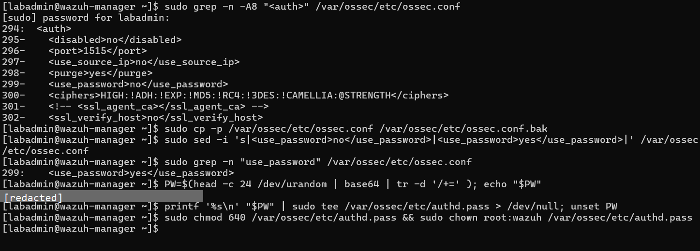

The generated password is redacted in the screenshot. The `<auth>` block shows the surrounding defaults:
port 1515, `purge` on, and `ssl_verify_host` off. The setting applies to new enrolments only, since the two
Windows agents already hold their keys.

The manager was then restarted so the setting takes effect:

```bash
sudo systemctl restart wazuh-manager
sudo systemctl is-active wazuh-manager
sudo ss -tlnp | grep 1515
```

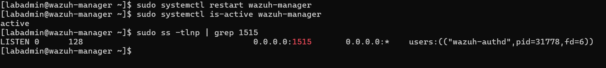

The manager is `active` and `wazuh-authd` is listening on `0.0.0.0:1515`. That is every interface, so the
lab network can reach the enrolment port as well as the tunnel; the control is now the password, together
with the firewall zones that decide who can reach the port at all. A check that both Windows agents remain
active is still to confirm.

## Testing the tunnel from the cloud VM

Before installing anything, the manager's tunnel address was probed from `gcp-node01` with bash's built-in
TCP redirection, so no extra tools were needed. A port counts as open if the connection completes within six
seconds:

```bash
for p in 1514 1515 22 443 55000; do
  printf "port %-6s " $p
  timeout 6 bash -c "exec 3<>/dev/tcp/100.73.251.78/$p" 2>/dev/null && echo OPEN || echo "refused/filtered"
done
```

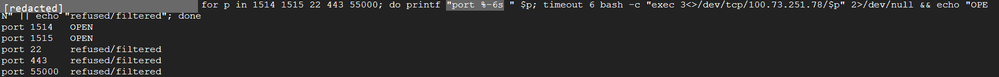

| Port | Service | Result |
|---|---|---|
| 1514 | Agent events | open |
| 1515 | Enrolment | open |
| 22 | SSH | refused or filtered |
| 443 | Dashboard | refused or filtered |
| 55000 | Wazuh API | refused or filtered |

This matches the design: the two agent ports answer and the three management ports do not. It is the first
live use of the access policy and the manager's `tailnet` zone together.

**What this does not prove.** The script cannot tell a refusal from a silent drop, and it cannot tell which
layer blocked a port. Two controls both say no to 22, 443 and 55000: the Tailscale policy and the `firewalld`
zone. A port blocked by either would look identical here. Showing that the `firewalld` layer works on its own
is still the separate test below. The OS Login username in the prompt is redacted in the screenshot.

## Still to do

- [x] Confirm `/etc/resolv.conf` still lists the two original nameservers after `tailscale up`: it lists
      the domain controller first and the NAT gateway second, so `--accept-dns=false` left DNS alone.
- [x] Write the access policy (tags `tag:manager` and `tag:cloud-agent`; the cloud VM may reach the manager
      on TCP 1514 and 1515 only); it saved, so its built-in tests passed.
- [x] Re-run `tailscale up` with `--advertise-tags=tag:manager`; the tag is applied in the console.
- [x] Disable key expiry for the manager in the console (done; the resulting page was not captured).
- [x] Put `tailscale0` in its own `firewalld` zone allowing only TCP 1514 and 1515, and check that
      `firewalld` still evaluates tunnel traffic after Tailscale's rules.
- [ ] Prove the `firewalld` layer on its own once the cloud VM exists: temporarily widen the Tailscale
      policy to allow all ports from it, confirm 22 and 443 are still refused, then restore the policy.
- [x] Multi-factor authentication is on for the Tailscale identity provider (not captured). The AWS
      root-user MFA is moot now that AWS is dropped.
- [ ] GCP guardrails, in order, before any resource is created:
  - [ ] Confirm 2-Step Verification is on for the Google account that owns the GCP billing account, and
        whether it is the same account as the Tailscale identity provider.
  - [ ] Do **not** use *Upgrade*. The trial ($300, shown as €269) expires 1 February 2027 and Google
        states there are no automatic charges; when it ends resources stop, and unless the account is
        upgraded during the grace period they are permanently deleted. The cloud node has a hard deadline.
  - [x] Create a dedicated project for the lab so everything can be torn down by deleting it
        (`mini-soc-lab`).
  - [x] Set a billing budget with alerts to an address that is checked, as a backstop and to watch how the
        credit is consumed (`lab-budget`, €10, with the Savings options cleared).
  - [ ] Choose a region and use it for everything (an EU region for latency; the always-free `e2-micro` is
        US-only and not needed during the trial).
  - [x] Check the project's default network for pre-created firewall rules that allow SSH or RDP from
        anywhere: it had them, so it was deleted and replaced by `lab-vpc`.
  - [x] Confirm `lab-vpc` has no firewall rules of its own and that its subnet is `10.20.0.0/24` in
        `europe-west8`.
  - [ ] No service-account key files: attach a minimally-scoped service account to the VM instead.
  - [ ] Read Google's acceptable-use and security-testing terms. Offensive testing stays on the local hosts
        regardless, so they only touch the misconfiguration demo, which changes this project's own settings.
- [x] Restart `wazuh-manager` so the enrolment password takes effect; it is active and listening on 1515.
- [x] Confirm `DC01` and `WIN10-CLIENT` still show as active after the restart (confirmed earlier, not captured).
- [x] The enrolment password was rotated after it appeared in a screenshot (not captured). A password
      change is only read when the enrolment service starts, so the manager must have been restarted after
      it; the first enrolment with the new password will show whether it was.
- [ ] Confirm the enrolment password is saved in the password manager, not in the repository.
- [x] Confirm from `gcloud compute firewall-rules list` that `allow-iap-ssh` has source range
      `35.235.240.0/20` and target tag `iap-ssh`, and that it is the only rule on `lab-vpc`. The listing
      shows exactly one rule with those values. The range is the one Google's documentation gives for IAP
      TCP forwarding ("all IP addresses that IAP uses for TCP forwarding").
- [x] Check whether an older `mini-soc` project holds anything: nothing was running in it.
- [x] Log in to `gcp-node01` through IAP with OS Login.
- [x] Launch the cloud VM with the `iap-ssh` tag (`gcp-node01`, created).
- [x] Join `gcp-node01` to Tailscale as `tag:cloud-agent` with a tagged auth key: connected, tag applied,
      expiry disabled.
- [x] Test from `gcp-node01` that the manager's tunnel address answers on TCP 1514 and 1515 and refuses
      22, 443 and 55000: 1514 and 1515 open, the other three refused or filtered (which layer blocked them
      is not shown by this test).
- [ ] Enrol the Wazuh agent on `gcp-node01` against the manager's tunnel address, using the enrolment
      password, and confirm it appears as active.
- [ ] Ship Cloud Audit Logs into Wazuh (the Wazuh GCP module reads Pub/Sub and Storage), then run the
      deliberate misconfiguration demo.
