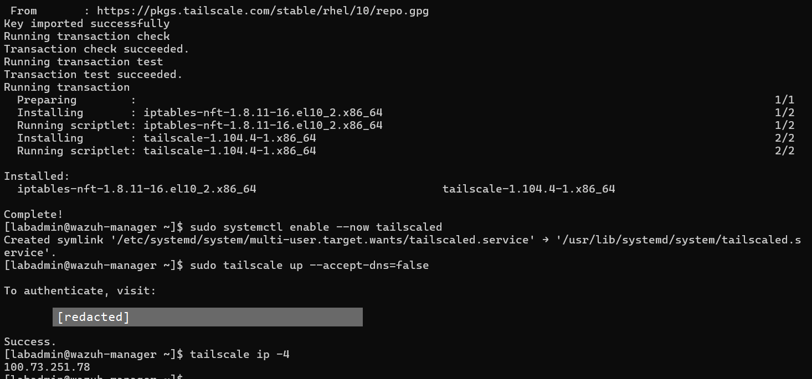
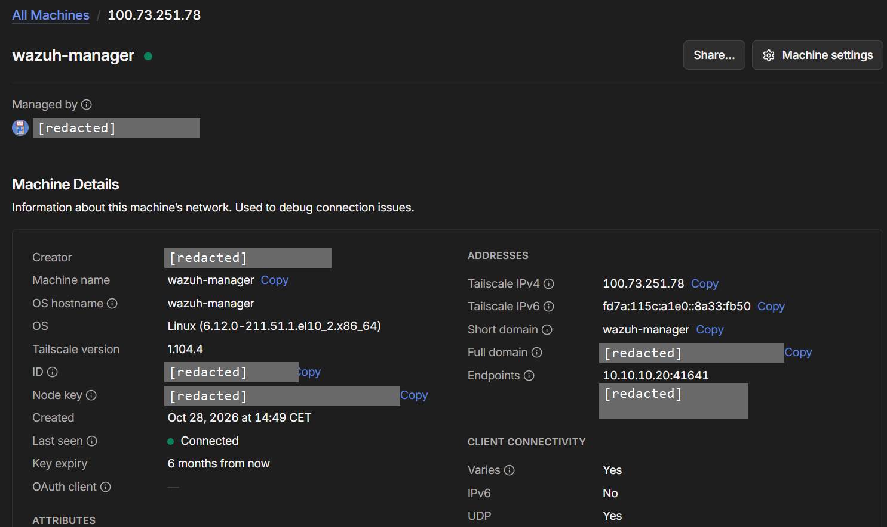

# Phase 3 — Cloud node build notes

Extends the lab with a cloud VM that reports to the on-premises Wazuh manager. The provider is **AWS**
(Free plan) and the link is a **Tailscale** mesh VPN; both choices and the rejected alternatives are in
[decisions.md](decisions.md), and the connectivity design is in [network-plan.md](network-plan.md).

## Tailscale on the manager

Tailscale is installed on the Rocky manager itself, so the tunnel terminates where the service runs,
rather than on the laptop. The repository definition was read before use: HTTPS, with both package and
repository signature checking enabled, and the signing key served from the same host.

```bash
sudo curl -fsSL https://pkgs.tailscale.com/stable/rhel/10/tailscale.repo -o /etc/yum.repos.d/tailscale.repo
sudo dnf install -y tailscale
sudo systemctl enable --now tailscaled
sudo tailscale up --accept-dns=false
```

The repo file was fetched directly rather than through `dnf config-manager`, which depends on a plugin that
a minimal install may not have.



The signing key was imported and the transaction checks passed. Tailscale 1.104.4 installed, along with
`iptables-nft` as a dependency. The login URL printed by `tailscale up` is a one-time link tying the machine
to an account, so it is redacted in the screenshot.

**`--accept-dns=false`.** On Linux, Tailscale by default takes over DNS configuration. That would risk
overwriting the resolver arrangement verified in Phase 1 (the domain controller first, the NAT gateway as
fallback), and this host does not need Tailscale's name resolution.

The manager received the tunnel address `100.73.251.78`. Tailscale's `100.64.0.0/10` range overlaps none of
the lab network, AWS's default VPC range, or Azure's.



The admin console shows the manager connected. Account email, device ID, node key, tailnet domain and
external endpoints are redacted. The page reports key expiry **six months from now**: untagged devices carry
the default expiry, so without a tag the manager would silently drop off the network after that period.
Tagging it, as described below, is expected to remove that.

## Access policy

Tailscale's default policy lets every device reach every other on every port. The cloud VM is the
internet-facing, less-trusted machine and the manager is the one that matters most, so the default is
replaced with a single permission. The file is versioned as [../cloud/tailscale-policy.json](../cloud/tailscale-policy.json);
it holds tags and ports only, nothing secret.


- **Tags** (`tag:manager`, `tag:cloud-agent`) label machines by role rather than by owner, so the rule
  survives rebuilding the cloud VM: a replacement with the same tag is covered without editing the policy.
  Tagged machines also authenticate with a pre-made key rather than a person's login, which suits servers.
- **One rule.** Machines tagged `cloud-agent` may open TCP connections to machines tagged `manager` on
  1514 (agent events) and 1515 (enrolment), and nothing else. Policy is default-deny, so SSH, the dashboard
  and the API are unreachable from the tunnel. Rules are stateful, so replies need no reverse rule.
- **Tests.** The policy carries assertions that the two Wazuh ports are allowed and that 22, 443 and 55000
  are denied. The console evaluates them on save and refuses a policy that contradicts them, and they
  re-run on every later edit, which guards against a typo opening something by accident.

This cannot lock out administration: the policy is managed through the account in the browser, and the
manager is reached over SSH on the lab network rather than the tunnel.

The manager was then tagged:

```bash
sudo tailscale up --accept-dns=false --advertise-tags=tag:manager
```

`tailscale up` requires every non-default flag to be restated, which is why `--accept-dns=false` appears
again. The command returned without error. Tailscale normally rejects an advertised tag the policy has not
defined, so that is indirect evidence the policy saved, but it is inferred, and the console is the proof.

## Still to do

- [x] Confirm `/etc/resolv.conf` still lists the two original nameservers after `tailscale up`: it lists
      the domain controller first and the NAT gateway second, so `--accept-dns=false` left DNS alone.
- [ ] Write the access policy (tags `tag:manager` and `tag:cloud-agent`; the cloud VM may reach the manager
      on TCP 1514 and 1515 only) and confirm its built-in tests pass.
- [ ] Re-run `tailscale up` with `--advertise-tags=tag:manager`, then confirm in the console that the tag
      is applied and key expiry is off.
- [ ] Put `tailscale0` in its own `firewalld` zone allowing only TCP 1514 and 1515.
- [ ] Confirm multi-factor authentication is on for the Tailscale identity provider and the AWS root user.
- [ ] AWS guardrails (budget, no public SSH or RDP, testing policy) before any resource is created.
- [ ] Launch the cloud VM, join it to Tailscale as `tag:cloud-agent`, and enrol its Wazuh agent against the
      manager's tunnel address.
- [ ] Ship CloudTrail into Wazuh, then run the deliberate misconfiguration demo.
