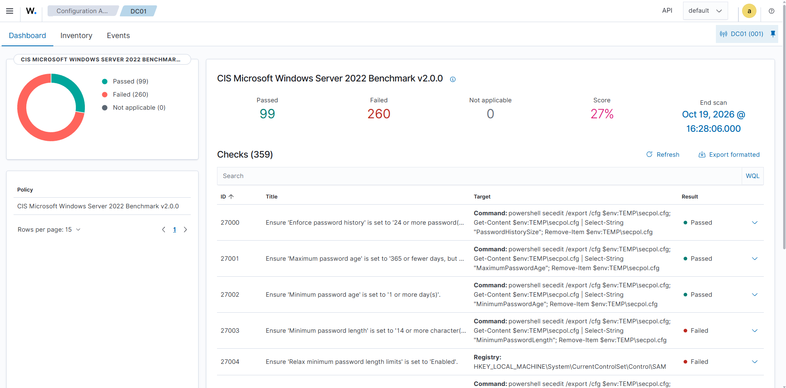
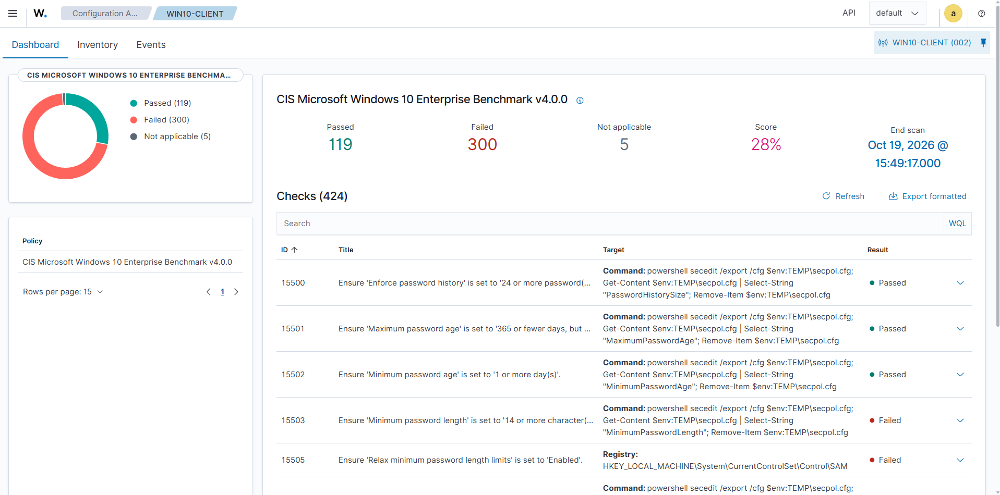

# Baseline compliance scores

Security Configuration Assessment (SCA) results taken **before any hardening**, so Phase 5 has an honest
starting point. Both hosts are as built in Phases 1 and 2: default Windows configuration, domain-joined,
with the Wazuh agent and Sysmon installed and no CIS controls applied.

Wazuh evaluates each host against a CIS Benchmark policy shipped with the agent. Scores below are as the
dashboard reports them (Configuration Assessment, per agent).

| Host | Policy | Checks | Passed | Failed | N/A | Score | Scan ended |
|---|---|---|---|---|---|---|---|
| `DC01` | CIS Microsoft Windows Server 2022 Benchmark v2.0.0 | 359 | 99 | 260 | 0 | **27%** | 19 Oct 2026, 16:28 |
| `WIN10-CLIENT` | CIS Microsoft Windows 10 Enterprise Benchmark v4.0.0 | 424 | 119 | 300 | 5 | **28%** | 19 Oct 2026, 15:49 |

`DC01`:

`WIN10-CLIENT`:

## Reading the numbers

- **A low starting score is expected.** A default Windows install is not configured to a CIS benchmark,
  and the passing checks are mostly things Windows already does (password history, age limits). Most of
  the failures are settings that are simply unset.
- **The delta matters more than the absolute figure.** Both policies are pinned to a benchmark version,
  so a later re-scan against the same policy is directly comparable. Changing the policy version between
  scans would make the comparison meaningless.
- **The policies don't match the installed editions exactly.** The client is Windows 10 **Pro**, scored
  against the **Enterprise** benchmark, which is why 5 checks are not applicable. The domain controller
  is scored against the Windows Server 2022 benchmark; CIS publishes separate controls for domain
  controllers and member servers, and whether this policy applies the right set to a DC has not been
  checked. Both need confirming before the final figures are quoted anywhere.

## Controls that will deliberately stay failing

Some findings are intentional, because Phase 4 depends on them:

- No account lockout threshold (`LockoutThreshold: 0`), so brute-force simulations don't lock accounts.
- A Domain Admin credential cached on the workstation is a behaviour rather than a setting, but the
  policy's credential-handling controls bear on how realistic the credential-theft scenario is.

Each control left failing on purpose gets a line in `docs/decisions.md` when Phase 5 starts, so the
final score reads as a choice rather than an omission. The reported improvement should say how many
failures were fixed, how many were deliberately kept, and how many could not be applied.
